<!-- docs/RELEASE-CHECKLIST.md lists what is still open in this file: the main video, the clips that are not recorded yet, the roadmap. -->

# Dynamic Island for KDE Plasma 6

A notch joined to the top edge of your KDE Plasma desktop: music, downloads, timers, calls and notifications show in it, and hovering opens its pages below.

[](#licence-and-thanks)


**English** · [Türkçe](README.tr.md)

<!-- TODO(owner): main video here (docs/RELEASE-CHECKLIST.md). -->

<!-- GIF: notch-states.gif | The notch at the top of the screen over a dark top panel shows the clock with the cat beside it; a message arrives and the notch widens to show its sender and first line; then a build with a filling progress ring, which ends in "Done". | The notch: idle, a notification, an activity -->
<p align="center">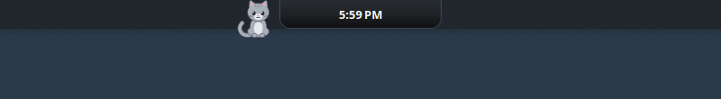<br><sub>The notch: idle, a notification, an activity</sub></p>

**In one sentence:** a Plasma widget that puts a small black notch at the top of the screen, like the one of a laptop or a phone, and fills it with what is going on right now (a song, a download, a timer, a call, a notification); hover it and it opens into pages for music, the system, the weather, your calendar, notes, quick settings and more. Every part can be switched off, and nothing is sent anywhere unless you connect something.

## Contents

- [What's new since 0.2.2](#whats-new-since-022)
- [The notch](#the-notch): [with a top panel](#with-a-top-panel) · [Notch settings](#notch-settings) · [Full screen](#full-screen) · [Dot mode](#dot-mode) · [States](#states)
- [Highlights](#highlights)
- [Requirements](#requirements)
- [Installing, updating, removing](#installing-updating-removing)
- [First steps](#first-steps)
- [The tabs](#the-tabs): [Activities](#activities) · [Media](#media) · [System](#system) · [Weather](#weather) · [Notifications](#notifications) · [Controls](#controls) · [Apps](#apps) · [Tools](#tools) · [Habits](#habits) · [Calendar](#calendar) · [Notes](#notes) · [AI](#ai) · [Cloud](#cloud) · [Clipboard](#clipboard)
- [The cat](#the-cat)
- [Passing events](#passing-events): [screen recording](#screen-recording-and-sharing) · [notifications](#a-notification-arrives) · [downloads](#downloads-and-file-transfers) · [incoming call](#an-incoming-call) · [privacy dots](#privacy-dots) · [suggestions](#suggestions)
- [Appearance, themes and the store](#appearance-themes-and-the-store)
- [The settings window](#the-settings-window): [search](#search-and-folded-details) · [tabs and language](#tabs-and-language) · [Diagnostics](#diagnostics-and-what-is-missing)
- [For developers: push your own activity](#for-developers-push-your-own-activity)
- [Performance](#performance) · [Privacy and the network](#privacy-and-the-network) · [Troubleshooting](#troubleshooting) · [Known limits](#known-limits) · [Contributing and security](#contributing-and-security) · [Licence and thanks](#licence-and-thanks)

## What's new since 0.2.2

These are on the `main` branch and come with an installation from a clone of it ([Installing](#installing-updating-removing)). **They are not in a tagged release yet:** *Update* on an installed 0.2.2 island does not bring them until the next version is published. Everything is listed in the [CHANGELOG](CHANGELOG.md#unreleased).

| | |
|---|---|
| **The notch, as it comes** | The island is joined to the screen's top edge, over a top panel, in the **Symbiot Black** gradient with a thin slate border. The rounded island of earlier versions is the *Oval layout* (Settings → Appearance → Layout). |
| **Full screen, four ways** | Over a full-screen window the island stays as it is, hides, slides up leaving a thin strip at the edge, or shrinks to a small nub; the last two on the desktop too after a while of nothing going on, if you want. [More](#full-screen) |
| **The notch's width** | Automatic, or set narrower or wider up to 1200 px, so that panel widgets beside it stay clickable; the open island can follow it. |
| **Size up to 240 %** | Kept within the screen; the settings say when its edge was reached. |
| **Colours of the buttons** | One button colour for the island's buttons, tiles and cards, and the Controls buttons each in their own colour or one for all. |
| **Requirements say themselves** | Where a feature needs something that is missing (the native module, `rclone`, `btop`, BetterNotes, `claude`…), it says what, why, and the command to copy for Kubuntu, Fedora or Arch. The island never runs that command. |
| **Settings → Diagnostics** | What each feature needs, whether it was found and where, the session, Plasma and Qt, a path set by hand, and *Copy diagnostics* for a bug report without your name or home folder. |
| **Simpler settings** | 15 pages instead of 18, details folded, a search over every setting, and *Response*: Calm, Balanced or Lively for the delays. No setting was removed or renamed. |
| **A short tour** | Three steps at a new island's first opening: the layout, the tabs, what this computer has. |
| **Time format** | The clock as the system's region writes it, or always 24 or 12 hours. |
| **The handle stays out of the way** | The widget's small icon on the desktop shows only while the desktop is being edited. |

**Updating from 0.2.2 or earlier** keeps your choices: an island that ran before keeps the layout it had (the oval one, unless you had switched the notch on in a build that had that switch) and says once that the notch is there; it is not shown the tour. Appearance settings you never changed take the new defaults, so a look left as it came becomes Symbiot Black: *Follow the system* in Settings → Appearance brings the old one back.

## The notch

The island is one piece joined to the screen's top edge, like the notch of a laptop's screen: square and straight where it meets the edge, rounded only at its lower corners. It hangs over a top panel (also one that hides itself) and grows downwards: for a notification, an activity, or its pages when you hover it. Pushing the pointer against the top edge above it opens it too: its topmost row of pixels takes the pointer.

<!-- GIF: notch-hover.gif | The pointer moves onto the notch and it opens downwards into its pages; the pointer leaves and it shrinks back; the pointer is pushed against the top edge above the notch and it opens again. | The notch: hover, close, push against the edge -->

It comes as the **Symbiot Black** gradient (charcoal `#292c30` through `#202326` to near black `#0e1012`) with a thin slate border (`#4c566a`, 70 %). The rounded island of earlier versions is still there: **Settings → Appearance → Layout → Oval layout**.

### With a top panel

- **The notch covers what is under it**, and that part of the panel cannot be clicked; beside the notch the panel takes its clicks as before. If a clock or task buttons sit in the middle of your panel, narrow the notch with **Width** (Settings → Appearance, under the layout): the island cannot read where a panel's widgets are. Notifications and the open island are wider for as long as they show.
- **Its height** follows the top panel (also while the panel is hidden), or is set by hand. Without a top panel it sits at the top edge all the same, as high as the island.
- **The cat** stands beside the notch, on the panel.
- **A dark panel** is where the notch looks most like part of the screen: the clips here use Breeze Dark with an opaque 32 px panel.

### Notch settings

**Settings → Appearance → Layout: Notch.** The first three are on the page; the rest are folded under *Notch details*.

| Setting | What it does |
|---|---|
| Colour | *The island's colours (Appearance)*: the look's colours or gradient, made opaque (as it comes); *Black*: opaque black with light text; *The island's look (Appearance)*: its material, opacity and blur too |
| Screen | The screen of the top panel (as it comes), or the primary screen. One notch at a time |
| Width | *Automatic* (as wide as what it shows), or set from narrow up to 1200 px at 100 % size; never past the screen |
| Preview | The notch small or as a dot, at the top of the details |
| Notch border | *Show an edge around the notch* (on as it comes): thickness 1–8 px, colour, opacity 0–100 %. Drawn along the sides and lower corners, never across the screen's edge |
| Upper corners | *Soften where it meets the edge*: two small curves outwards (off as it comes) |
| Height | The top panel's (as it comes), or set by hand (24–72 px) |
| When open | *Open it as wide too, where that is wider than the open island* (on as it comes) |
| Full screen | With *Slides up* or *Shrinks* ([below](#full-screen)): also for a window that reaches under the notch, and the size and width while it is open there |
| Cat | *Hide the cat in the notch layout* |

Not used by the notch: the distance from the top, *Place below top panels*, and the look's own border and shadow (those are the oval layout's). More in the [reference](docs/REFERENCE.md#layout-notch--oval-layout).

### Full screen

**Settings → Appearance → Full screen**, for both layouts. What the island does while a window fills its screen:

| Choice | What happens | How it comes back |
|---|---|---|
| Stays as it is | Nothing changes | – |
| **Hides** (as it comes) | It is gone | When the window leaves full screen |
| Slides up, a thin strip shows | It moves up to the edge, as large as it is, until only a few pixels show; clicks beside the strip go to the window | The pointer at the top edge, after a short rest |
| Shrinks to a small nub | It draws in to a small nub at the edge | The pointer on the nub |

- **Also:** *For maximised windows* (off as it comes: only a real full-screen window counts, in any application: a video, a browser's F11, a terminal, a game). *On the desktop when nothing is going on, after* 2–300 s (10 as it comes, off as it comes): sliding up or shrinking happens on the empty desktop too; a notification, a live activity or opening it brings it back at once.
- **Full-screen details:** how much of the strip shows (2–16 px, 4), how long the pointer rests before it opens (0–1000 ms, 150), how wide the place at the edge is that opens it, and whether an incoming call opens it. A recording, the microphone or camera, a critical warning and a call colour the strip. A live preview with *Try it*.
- **What counts:** only the window in front, on the island's own screen and on the desktop and activity shown. A full-screen window on another virtual desktop does nothing.
- **Wayland only.** Elsewhere a window that fills the screen lies over the island, which then stays as it is. Details: [reference](docs/REFERENCE.md#full-screen-mode).

### Dot mode

A click on the notch shrinks it to a dot (a small half circle at the edge, 15 px; 10–28 in the settings), so that it is out of the way; a click on the dot brings the notch back. What is under the rest of the panel stays clickable.

<!-- GIF: dot-mode.gif | A click shrinks the notch to a small half circle at the top edge; a button of a window right beside it is clicked; a click on the dot brings the notch back. | Dot mode -->

The dot's centre says what is going on: orange, green or red for the microphone, the camera or the screen in use; the accent colour for a live activity (pulsing) or waiting notifications. While it is a dot, notifications and events are kept for later (or shown and then back to the dot: *Events in dot mode*). An incoming call, an alarm and low battery open it in every case unless you switch that off.

**Settings → General → Dot mode:** on/off; under *Dot mode details*: start as (as it was left, always the notch, always the dot), dot size, whether hovering the dot opens the island, events in dot mode, always open for critical events.

### States

| State | When | What you see |
|---|---|---|
| Idle | Nothing is going on | The clock |
| Live activity | Something lasts (music, a timer, a transfer, a recording, a call) | Its icon or cover on the left; its time, value or progress ring on the right |
| Split | Two things last at once | The first in the notch, the second in a small notch of its own beside it |
| Notification | One arrives | App, title, first line. A click runs its default action, a middle click dismisses it |
| Passing event | Volume, brightness, charging, Bluetooth, Caps Lock, Wi-Fi… | A wider notch for a few seconds (3 s as it comes) |
| Suggestion | A rule's moment (off as it comes, see [Suggestions](#suggestions)) | A sentence with its answers as buttons |
| Open | Hover, or a click with dot mode off | The pages below |
| Privacy dots | Microphone or camera in use | An orange or green dot beside the notch, in every state |
| Dot | After a click, in dot mode | A small half circle at the edge |
| Slid up / nub | Over a full-screen window, if [chosen](#full-screen) | A thin strip at the edge, or a small nub |

Which activity wins when several last at once is a list you can reorder (Settings → Activities → *Priority*): privacy, call, screen recording, passing events, timer, transfers, media.

## Highlights

| | |
|---|---|
| **Live activities** | Music with its cover, a timer, a transfer with its progress, a screen recording, a call. Two at once split the notch in two. |
| **Passing events** | Volume, brightness, charging, Bluetooth, Caps Lock, a new notification: a few seconds, then back to what was there. |
| **Tabs** | Hover to open: Media, System, Weather, Notifications, Controls, Apps, Tools, Habits, Calendar, Notes, Clipboard, and (off until you switch them on) AI and Cloud. |
| **A cat** | Beside the notch: it sleeps, wears headphones for music, likes to be stroked. It can be switched off. |
| **Your look** | Symbiot Black as it comes; nine more ready-made looks, your own colours or gradient, or Plasma's colours. Looks are exported and shared as files. |
| **Out of the way** | Over full screen it hides, slides up or shrinks; a click makes it a dot. |
| **Says what it needs** | A missing program or module is named where it matters, with the command to copy; Settings → Diagnostics lists all of it. |
| **Yours to script** | Any program can show its own activity through a small D-Bus API (`island-push`). |
| **Private by default** | No telemetry. The only request with the settings as they come is a daily look at the newest version number; see [Privacy and the network](#privacy-and-the-network). |

It is a Plasma widget (a plasmoid) written in QML, with an optional small native module (C++) for what QML cannot reach. Every part can be switched off.

## Requirements

| | |
|---|---|
| Desktop | KDE Plasma 6 (the widget declares Plasma API 6.0 as its minimum) |
| Tested on | Kubuntu 26.04, Plasma 6.6.6, Qt 6.10.2, KWin on **Wayland**, NVIDIA driver. Nothing else was tried. |
| X11 | **Not tested.** The notch then goes to the top edge, but whether it stays over the panel is up to the window manager, and the full-screen choices other than *Hides* do nothing (see [Known limits](#known-limits)). |
| To build the native module | `cmake`, `extra-cmake-modules`, Qt 6.5 or newer development files (Core, Gui, Qml, DBus, Network, Sql), `libkf6windowsystem-dev`. Settings → Diagnostics shows the package names for Kubuntu, Fedora and Arch |
| At run time | PipeWire's `pw-dump` (package `pipewire-bin` on Ubuntu) for the microphone, camera and screen-recording indicators |

Without the native module the widget still runs, and every feature that needs it says so where it is shown, with what to install, instead of breaking: the notch on a screen other than the primary one, the shaped blur, clicks passing through beside the island, the recording, microphone and camera indicators, unlock, KDE Connect calls, the update count, the D-Bus API, calendar accounts and every password or key (they live in KDE Wallet), theme files, download tracking, buttons that start a program, the Cloud and AI helpers.

**Optional programs.** None is needed; each adds one thing.

| Program | What it adds |
|---|---|
| [rclone](https://rclone.org) | The Cloud tab: your rclone remotes (Google Drive, OneDrive, Dropbox, WebDAV…) |
| [BetterNotes](https://github.com/thebanri/BetterNotes) 0.1.13+ | Notes on this computer, no account (0.1.14 to open a note in the app, 0.1.15 for locked notes) |
| Joplin (desktop), a Simplenote account, a Memos server | Their notes on the Notes tab |
| KDE Connect | Phone battery, calls, notifications from the phone, "find my phone" |
| Claude Code (`claude`), Antigravity (`agy`) | The AI tab answers through them, with every tool switched off |
| Ollama, LM Studio, llama.cpp, Jan, KoboldCpp | The AI tab answers from a model on this computer |
| `btop` 1.4+ | A click on a System card opens that metric's graph in a terminal |
| Spectacle, Discover, a camera app | The matching buttons on the Controls tab |
| PackageKit | The number of waiting updates |

## Installing, updating, removing

```bash
git clone https://github.com/Phobby/plasma-island.git
cd plasma-island
./install.sh               # the widget, the native module and island-push
systemctl --user restart plasma-plasmashell
```

Or all of it as one line to copy and paste:

```bash
git clone https://github.com/Phobby/plasma-island.git && cd plasma-island && ./install.sh && systemctl --user restart plasma-plasmashell
```

`install.sh` asks for no password and downloads nothing: it installs the widget for your user with `kpackagetool6`, builds the native module with CMake and puts it in `~/.local/lib/qml`, puts `island-push` in `~/.local/bin`, and makes the module visible to plasmashell (`QML_IMPORT_PATH` in `~/.config/environment.d/90-dynamicisland.conf`). Running it again upgrades in place. A clone of `main` brings everything in [What's new](#whats-new-since-022).

| | |
|---|---|
| Widget only, no native module | `./install.sh --no-native` (what needs the module then says so) |
| By hand | `kpackagetool6 -t Plasma/Applet -i org.phobby.dynamicisland` (`-u` to upgrade) |
| Update | The island asks when there is a new version: *Update* fetches it, builds it, installs it and restarts the shell (see below). By hand: `git pull`, then `./install.sh` and restart plasmashell |
| Remove | `./install.sh --remove`, then restart plasmashell |

**Updating keeps everything.** An update only replaces the widget's files and the native module; nothing is removed first. Your settings, connected accounts, themes and data stay as they are, whichever way you update. Settings that changed their place or meaning are brought up to date once, by themselves (the settings have a version of their own); see [What's new](#whats-new-since-022) for what that keeps.

<details><summary>Updating from the island, or with commands</summary>

- **From the island (0.2.0 or newer).** Once a day the island reads the newest version number from this repository. When there is a newer one it asks on the island: *Update* downloads that version (the tag's archive from GitHub), builds and installs it for your user, and restarts the desktop shell; the island shows how far it is meanwhile. Settings → General → *New versions of the island* chooses between *Never look*, *Ask me* (as it comes) and *Install by itself* (it then asks only before the shell restarts). Installing needs the native module and `curl`; without the module the island only says that a new version exists.
- **By hand, with commands.** Which version is installed and which is the newest (0.2.2 or newer):

  ```bash
  sh ~/.local/share/plasma/plasmoids/org.phobby.dynamicisland/contents/scripts/island-update.sh --check
  ```

  It prints `installed 0.2.1` and `newest 0.2.2`. With an older island: `grep Version ~/.local/share/plasma/plasmoids/org.phobby.dynamicisland/metadata.json` (the newest is the badge at the top of this page).

  Updating to the newest version, without the folder you cloned (0.2.0 or newer); it downloads, builds, installs and restarts the shell:

  ```bash
  sh ~/.local/share/plasma/plasmoids/org.phobby.dynamicisland/contents/scripts/island-update.sh latest --restart
  ```

  In the folder you cloned (the only way from 0.1.0, which has no updater, and the way to get what is on `main` before it is released):

  ```bash
  git pull && ./install.sh && systemctl --user restart plasma-plasmashell
  ```

</details>

**Taken off the desktop and put back, the island comes as it was** (0.2.2 or newer, with the native module). Plasma deletes a widget's settings when the widget is removed; the island therefore also keeps them in `~/.local/share/dynamicisland/settings.json` (readable by you only), and a widget that is new reads them from there once. To start from nothing instead, delete that file before adding the widget (or use *Defaults* in the settings).

Removing leaves your data where it is: `~/.local/share/dynamicisland/` (the copy of your settings, themes you added, what the suggestions learned, a kept AI chat), `~/.cache/dynamicisland/` (files fetched from a cloud), the folder "Dynamic Island" in KDE Wallet, and the widget's settings in Plasma's own file until you take the widget off the desktop. Delete them by hand if you want them gone.

**Putting it on the screen.** The island is a window of its own, so it does not matter where the widget goes:

1. Right click the desktop (or a panel in edit mode) → *Add Widgets…* → "Dynamic Island".
2. The island appears at the top centre of that screen. The widget itself is only a small handle icon, shown while the desktop is being edited (to move or remove it).
3. The notch joins the top edge, over any top panel. Change it, or choose the oval layout, in Settings → Appearance → Layout.

Plasma's own volume popup keeps appearing beside the island's. To keep only one: Settings → Activities → switch off "Volume, brightness and audio output" in the island, or switch off the volume popups in System Settings → Sound. (Plasma has no switch for its brightness popup.)

## First steps

- **The tour.** A new island's first opening shows three short steps: notch or oval layout, which tabs are on, and what this computer is missing. *Skip* ends it; Settings → Diagnostics → About shows it again.
- **Hover** the notch: it opens. Move away: it closes (after 0.4 s; Settings → General → *Response*: Calm, Balanced or Lively, or each delay by hand under *Customize*).
- **The tabs** along the top switch pages; so does the mouse wheel or a two-finger swipe over anything that is not a list.
- **Click** the notch: it shrinks to a dot. Click the dot: the notch is back ([Dot mode](#dot-mode) can be switched off; a click then opens the island).
- **Right click** the island for its menu; the gear at the top right of the open island opens the settings.
- **Settings → Tabs** shows, hides and orders the tabs. AI and Cloud are off until switched on there.
- **Language**: the island speaks Turkish when the system does, English otherwise; Settings → General → *Language* changes it at once.

## The tabs

Every tab below follows the same pattern: what it is for, a clip, what you see, how to use it, and (folded) its settings and limits. A tab's own settings page is in the sidebar of the settings window while the tab is on.

<!-- GIF: tabs-tour.gif | The pointer opens the notch and moves along the tabs: Media, System, Weather, Calendar; each page slides in below the notch. | A tour of the tabs -->

### Activities

*Everything that is going on, with its buttons.* The tab appears only while something is.

<!-- GIF: activities-page.gif | The open notch on the Activities tab with a running timer and a download, each with its own buttons. | The Activities tab -->

- **What you see:** one card per ongoing activity (timer, transfer, recording, call, media…), with its actions, and which application uses the microphone or camera.
- **How to use:** the buttons on a card act on that activity (pause a timer, open the folder of a finished download, switch to the recording application).

<details><summary>Settings</summary>

Settings → Activities: the split island, a switch for every kind of event and activity, the priority order, and folded: *Warning thresholds* (battery, device battery, CPU and GPU temperature) and *Download tracking details*.

</details>

### Media

*What is playing, and its controls.*

<!-- GIF: media-controls.gif | The notch shows a cover, a track's name and an equalizer; the next track comes; it is paused and played again. | Media on the notch: the next track, pause and play -->
<p align="center">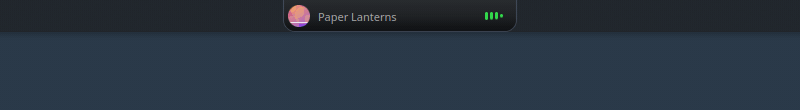<br><sub>Media on the notch: the next track, pause and play</sub></p>
<!-- GIF: media-page.gif | The open Media tab: cover, title and artist, previous, play and next, the position being dragged. | Media: the tab and its controls -->
<!-- GIF: media-glow.gif | With music playing the notch's lower edge starts to glow in the cover's colour and moves with the music; then the glow is switched off again. | Media: the album glow -->
<p align="center">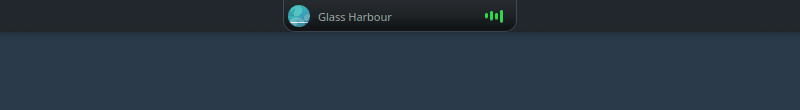<br><sub>Media: the album glow</sub></p>

- **What you see:** on the notch the cover, the track's name and an equalizer; on the tab cover, title, artist, position, previous / play / next.
- **How to use:** the buttons and the position bar control the player. The wave button at the top right of the tab switches the **album glow**: the island's edge takes the cover's colour and moves with the music's loudness and bass. The cat puts on headphones and nods along ([The cat](#the-cat)).

<details><summary>Settings and limits</summary>

- **Settings:** Settings → General → *Preferred player* (for example `spotify`: shown when it plays, whatever else does). The glow is off as it comes.
- **Limits:** any player that speaks MPRIS (most do, browsers too). The glow follows the music only with the native module (it listens to the output through `pw-record` while something plays); without it the glow only takes the colour.

</details>

### System

*How busy the computer is.* Information only.

<!-- GIF: system-cards.gif | The System tab: cards for CPU, temperature, GPU, memory, network and disk; the card under the pointer grows and shows details. | System: the cards -->

- **What you see:** cards for CPU, CPU temperature, GPU, memory, battery, network down/up and disk. In the *Dynamic* view the busiest cards are larger; in the *Fixed* view every card keeps its place.
- **How to use:** the card under the pointer grows and shows its details (the network card names the active connection). A click opens `btop` in your terminal with that metric's graph.

<details><summary>Settings and limits</summary>

- **Settings:** Settings → Tabs → *System view* (Fixed / Dynamic). Settings → Activities → *Warning thresholds*: battery, device battery and temperature.
- **Limits:** the values come from Plasma's sensor service (ksystemstats), which the island starts if it is not running. A sensor the driver does not offer hides its card. The click needs the native module and `btop` 1.4 or newer; without them the card says which is missing.

</details>

### Weather

*Now and the next seven days, for a place you choose.*

<!-- GIF: weather-location.gif | The Weather tab starts empty with "Choose a Location"; a city is typed and picked; the forecast appears; a day is clicked and its hours slide in. | Weather: choosing a place, a day's hours -->

- **What you see:** temperature, what it feels like, humidity and wind now; seven days with high, low and the chance of rain; the tab itself shows the weather's picture.
- **How to use:** it starts empty: *Choose a Location*, type a city, pick it. A click on a day shows its hours; the arrow goes back. The place's name opens the search again.

<details><summary>Settings and limits</summary>

- **Settings:** Settings → Weather: the place (search, forget), units (°C, km/h, mm or °F, mph, in), the alert for rain, snow and storms.
- **Limits:** the data is [Open-Meteo](https://open-meteo.com)'s. The place is never detected, and nothing is asked until you choose one.

</details>

### Notifications

*The last notifications, with reply and dismiss.* How one arrives on the notch: [A notification arrives](#a-notification-arrives).

<!-- GIF: notifications-page.gif | The Notifications tab lists the last three with their time; "Clear all" asks once and empties the list. | Notifications: the list, clear all -->

- **What you see:** the last three notifications with their arrival time.
- **How to use:** under the pointer: quick reply (where the notification offers one) and dismiss; *Clear all* asks once.

<details><summary>Settings and limits</summary>

- **Settings:** Settings → General: show incoming notifications, and under *Response* for how long. While Do Not Disturb is on they are held back and counted.
- **Limits:** Plasma's own notification popups stay: the island shows notifications in addition (they can be moved to another corner in System Settings → Notifications).

</details>

### Controls

*Quick settings, like a phone's.*

<!-- GIF: controls-tiles.gif | The Controls tab: Do Not Disturb and dark mode are switched, the volume slider is moved; holding a button makes them wiggle for editing. | Controls: buttons and sliders -->

- **What you see:** up to six buttons of your choice and, below, the volume and screen brightness sliders.
- **How to use:** a click switches a button. Holding one edits the set (drag to move, "−" to remove, add from the row below, *Done*). Holding **Bluetooth**, **Wi-Fi** or **VPN** opens its devices or networks instead.

<details><summary>Settings and limits</summary>

- **Available buttons:** Do Not Disturb, Night Light, power profile, Bluetooth, Wi-Fi, updates, airplane mode, VPN, hotspot, record screen, screenshot, camera, microphone, sound, KDE Connect, find phone, dark mode, keep awake, lock, calculator, System Settings. A button whose part is missing is dimmed and says what it needs.
- **Settings:** Settings → Controls: the same six, in order, and their **colours**: switched on, each in its own colour or one for all; switched off, as the island's buttons or one for all; and a colour of a button's own (vivid on, muted off). Settings → Tabs → *Modules*: the volume slider.
- **Limits:** the brightness slider needs a display Plasma can dim. Buttons that start a program (screenshot, calculator, lock…) need the native module.

</details>

### Apps

*Shortcuts to the applications you choose.*

<!-- GIF: apps-grid.gif | The Apps tab: "Add" lists the installed applications, one is added; a click starts it; two icons are dragged into another order. | Apps: add, start, reorder -->

- **What you see:** a grid of up to 12 icons; a dot under one means it has a window open.
- **How to use:** *Add* lists the installed applications with a search. A click starts one and closes the island; a right click renames or removes; dragging reorders.

### Tools

*Timer, stopwatch, Pomodoro and alarm.*

<!-- GIF: tools-timer.gif | A one-minute timer is started; the island closes and the notch counts down; the stopwatch takes laps; the Pomodoro's statistics are shown. | Tools: timer, stopwatch, Pomodoro -->

- **What you see:** four tools on one tab; whichever runs shows on the notch as a live activity.
- **How to use:** set and start. The Pomodoro counts its rounds (focus, short break, long break) and keeps statistics: today, this week, the streak, the total.

<details><summary>Settings and limits</summary>

- **Settings:** Settings → Tools: the sound (any file), Pomodoro lengths (25, 5 and 15 minutes as it comes) and rounds (4), reset the statistics.
- **Limits:** end times are stored, so a timer carries on if plasmashell restarts.

</details>

### Habits

*A daily checklist, an evening review, a calendar of how the days went.*

<!-- GIF: habits-checklist.gif | Habits are ticked on today's list; the evening question "How was today?" opens the review; the calendar shades the days like a contribution graph. | Habits: ticking, the evening review, the calendar -->

- **What you see:** today's list; a calendar that shades each day by how much was done (weeks, months, the year).
- **How to use:** the first time it asks for your habits and the time of the review. During the day a click ticks an entry. In the evening the island asks "How was today?": *Review* walks through the day and what to add for tomorrow.

<details><summary>Settings and limits</summary>

- **Settings:** Settings → Habits: the habits (rename, delete, order), the review time (21:30), its reminder, the calendar's colours, reset all data.
- **Limits:** everything stays in the widget's settings on this computer.

</details>

### Calendar

*Your calendars' events, and the next one pinned to the notch before it starts.*

<!-- GIF: calendar-pinned.gif | An event on the notch counts down its last seconds, turns into "started" with its room and a Join button, then shows the time left. | Calendar: the next event on the notch -->
<p align="center">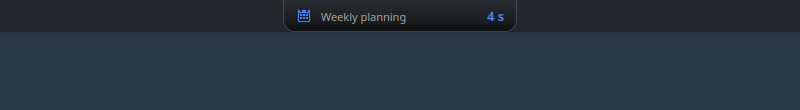<br><sub>Calendar: the next event on the notch</sub></p>
<!-- GIF: calendar-connect.gif | The gear on the Calendar tab opens "Connect a Calendar": Google or Apple is chosen, a link is pasted, the month fills with events. | Calendar: connecting one -->

- **What you see:** a month, the events of the chosen day and their details (place, notes, a meeting link). 15 minutes before an event starts it is pinned to the notch with a countdown; at the start a sound plays, and it stays 10 minutes after the end.
- **How to use:** the gear → *Connect a Calendar* → Google or Apple → either paste the calendar's private `.ics` link (read only), or connect the account (then events can be added and deleted from the island).

<details><summary>Settings and limits</summary>

- **Settings:** Settings → Calendar: minutes before and after, all-day events, how often links are fetched (5 minutes), the sound, the connected calendars.
- **Limits:** no Akonadi or KDE PIM is needed. An iCloud account needs an app-specific password; a Google account needs an OAuth client of your own, made once in the Google Cloud Console (the tab walks through it). Passwords and tokens are kept in KDE Wallet. Links are polled, so a new event shows after one interval at the latest; an existing event cannot be edited.

</details>

### Notes

*A quick note, and the notes of the apps you use.*

<!-- GIF: notes-quick.gif | On the Notes tab a source is chosen, a note is created with a title and filled in; it appears in the list. | Notes: creating one -->
<!-- GIF: notes-locked.gif | A locked BetterNotes note asks for the master password on the island and then shows its text. | Notes: a locked note -->

- **What you see:** one list of the notes of every connected app, newest first, and a field for a quick note.
- **How to use:** type and press Enter for a quick note in the default app; the magnifier searches; a click opens a note for editing (saved when you stop typing, on Ctrl+S and when you go back). The island comes back to the note you were editing.

<details><summary>Sources, settings and limits</summary>

- **Sources:** BetterNotes (on this computer, no account), Joplin (its Web Clipper service and token), Simplenote (the account), Memos (your server and a token).
- **Settings:** Settings → Notes: the connected apps, where quick notes go, how often they are fetched, carrying on in the last note.
- **Limits:** tokens are kept in KDE Wallet. A locked BetterNotes note asks for the master password (BetterNotes 0.1.15 or newer; with an older one the island offers to open it in the app); the password goes to the command's standard input and is kept nowhere. Rich-text notes are shown as plain text and are read-only. A BetterNotes that is not found, or too old, is said on the tab with what to do.
- **Thanks:** BetterNotes is made by [thebanri](https://github.com/thebanri/BetterNotes). Thank you for the app and for its command-line interface, which is what this tab talks to.

</details>

### AI

*A box for quick questions.* Off until you switch it on.

<!-- GIF: ai-question.gif | A question is typed on the AI tab; three dots show that the answer is on its way; the answer appears as formatted text. Answered by a demo server with canned answers. | AI: a question and its answer (demo provider) -->

- **What you see:** a field, the answer as it is written (Markdown, code in boxes with *Copy*), and on the notch three dots while it is on its way and "Answer ready" when you were elsewhere.
- **How to use:** Settings → Tabs: switch *AI* on. On the tab connect what should answer, then type; Enter sends, Shift+Enter is a new line. *New chat* starts over; Escape gives the keyboard back.

<details><summary>Sources, settings and limits</summary>

- **What can answer:** Claude Code or Antigravity on this computer; a model server on this computer (Ollama, LM Studio, llama.cpp, Jan, KoboldCpp or any OpenAI-compatible address); a service with your own key (Anthropic, OpenAI, OpenRouter, Groq, Google Gemini or another OpenAI-compatible one).
- **Settings:** Settings → AI: the sources and the default one, the longest answer and question, *Keep the chat in a file*, "Answer ready" on the island.
- **Limits:** it is a question box, **not an agent**: nothing is given a tool or a file, and nothing of your clipboard, screen, notes or calendar is added. Keys are kept in KDE Wallet. A question to a service is sent to that service and may cost what that service charges. The chat is forgotten when the shell stops unless you choose to keep it.

</details>

### Cloud

*Your clouds' folders by name, through rclone.* Off until you switch it on.

<!-- GIF: cloud-browse.gif | The Cloud tab lists a remote's folders; a folder is opened; a file is dragged out to the desktop; another is dropped in to upload. Shown with a made-up remote. | Cloud: browse, drag out, drop in (a made-up remote) -->

- **What you see:** each rclone remote with how full it is, its folders and files with size and date, a sync state where a client reports one (Syncthing, Dropbox), and a warning when a cloud is nearly full.
- **How to use:** Settings → Tabs: switch *Cloud* on. Click into folders; drag a file out to the desktop or a file manager; drop files on the tab to upload (it asks first). *Download*, *Show in folder*, *Copy path* and *Upload…* do the same without dragging.

<details><summary>Settings and limits</summary>

- **Settings:** Settings → Cloud: which remotes are shown and under which name, the thresholds (90 % and 98 %), alerts and their pause, the question before an upload, the cache and *Clear cache*.
- **Limits:** needs `rclone` with at least one remote (`rclone config`); the tab shows how to set it up when it is missing. The island only runs the `rclone` command: it can list, measure, copy from and copy to; it cannot delete, move, rename or sync. rclone's own configuration and tokens are never opened.

</details>

### Clipboard

*What was copied recently.*

<!-- GIF: clipboard-history.gif | The Clipboard tab lists made-up copied texts and a picture; a click copies one again; the search narrows the list. | Clipboard -->

- **What you see:** the history of Plasma's own clipboard (Klipper): texts, code, pictures, files.
- **How to use:** a click copies an entry again; under the pointer: star, QR code, edit, Klipper's actions, remove. A search field and a starred-only filter.
- **Limits:** how much is kept is Klipper's own setting; the island stores nothing of it.

## The cat

A small cat stands beside the notch, on the panel. It changes nothing, keeps nothing and asks nothing of the network.

| It… | When |
|---|---|
| falls asleep | after 20 s of the island showing nothing but the clock |
| wakes up and looks | at an event: a notification, a call, a timer that runs out |
| puts on headphones and nods | while music plays (see [the clip](#media) in Media) |
| thinks along | while the AI answers: a bubble beside its head |
| likes it | when stroked: the pointer back and forth over it |
| is startled, or angry | at a click, at too many, or when woken; then it sulks (10 s) |

<!-- GIF: cat-sleep.gif | The cat beside the notch curls up and sleeps; a notification arrives and it looks up. | The cat: asleep, and woken by a notification -->
<p align="center">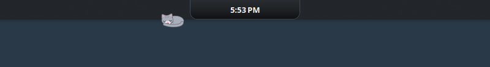<br><sub>The cat: asleep, and woken by a notification</sub></p>
<!-- GIF: media-cat.gif | Music starts; the cat beside the notch puts on headphones and nods along. | The cat: headphones and nodding -->
<p align="center">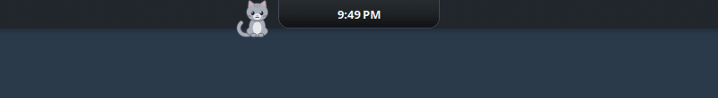<br><sub>The cat: headphones and nodding</sub></p>
<!-- GIF: cat-petting.gif | The pointer strokes the cat from side to side and hearts rise. | The cat: stroking -->
<!-- GIF: cat-annoyed.gif | The sleeping cat is clicked; it gets annoyed and sulks. | The cat: woken up -->

<details><summary>Settings, switching it off, less motion</summary>

- **Settings → Cat:** *Show the cat beside the island* (switches it off), the side, size, coat (grey, orange, black, white, black and white, or a colour of your own), what it reacts to (music, the AI and questions, events), whether it may be stroked and clicked, *Never angry*, how long it sulks, when it falls asleep, asleep or hidden beside the dot. The page has buttons to try each reaction.
- **In the notch layout only:** Settings → Appearance → *Notch details* → *Hide the cat in the notch layout*.
- **Less motion:** *Reduce motion: still poses, nothing nods or floats*. With the desktop's own animations switched off (System Settings) it stands still whatever is set.

</details>

## Passing events

Things that happen show on the notch for as long as they last, or for a few seconds, and then it is back to what was there.

### Screen recording and sharing

<!-- GIF: recording-indicator.gif | A screen recording starts: the notch shows a blinking red dot, "Screen recording" and the time counting up; the recording stops and the notch goes back to the clock. A stand-in video stream was used. | Screen recording: the red dot and its time -->
<p align="center">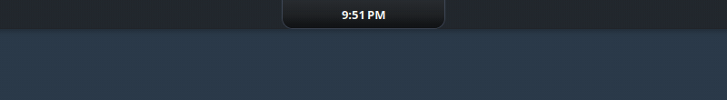<br><sub>Screen recording: the red dot and its time</sub></p>

Whenever a program records or shares the screen through PipeWire, the notch shows a blinking red dot, "Screen recording" and how long it has run. The Activities tab names the program and switches to it. Needs the native module and `pw-dump`; Settings → Activities switches it off.

### A notification arrives

<!-- GIF: notifications-arrival.gif | A message arrives: the notch widens to show the app, the sender and the first line; a few seconds later a second one from another app; then the clock again. | Notifications on the notch -->
<p align="center">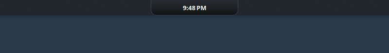<br><sub>Notifications on the notch</sub></p>

The notch widens to show the app, title and first line for 4 s (Settings → General → *Response*). A click runs its default action, a middle click dismisses it. The last three, with their time and *Clear all*, are on the [Notifications](#notifications) tab.

### Downloads and file transfers

<!-- GIF: downloads-tracking.gif | A download started with curl from a local test server appears on the notch with its megabytes and a ring that fills, then "Finished" with its size and time. | Download tracking (a download from a local test server) -->
<p align="center">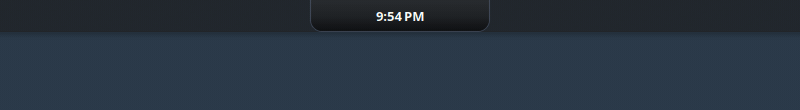<br><sub>Download tracking (a download from a local test server)</sub></p>

One kind of activity for everything that moves files: its name, "412 MB / 1.8 GB", per cent, speed, time left, and at the end a button to open the file or its folder.

| Source | What is shown |
|---|---|
| Dolphin, Ark, uploads to remote folders (KDE's job system) | Everything, exactly |
| KDE Connect, USB sticks and external disks | The same, through the job system |
| Browser downloads | Size, speed and time left, read from the download folder |
| `git clone`, `wget`, `curl`, `pip download` | Found by their process; bytes and speed from what they wrote |
| `apt`, PackageKit (Discover) | The stage and, where known, the progress |

**Settings → Activities:** the *Download tracking* switch; under *Download tracking details* each source, background jobs, how long and how large something must be to be shown, the watched folders and your own commands. Commands are found by looking at the process list every three seconds; nothing is installed or wrapped. What was and was not tried with the real programs is in the [reference](docs/REFERENCE.md#file-transfers-what-can-and-cannot-be-tracked).

### An incoming call

<!-- GIF: call-incoming.gif | The cat sleeps beside the notch; a call comes in: the notch widens with a green phone icon, the caller's name and number and a Mute button, and the cat wakes. Made-up caller. | An incoming call through KDE Connect (made-up caller) -->
<p align="center">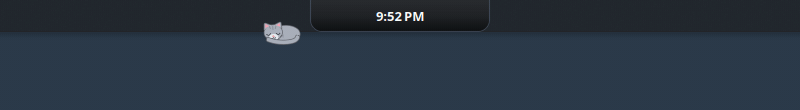<br><sub>An incoming call through KDE Connect (made-up caller)</sub></p>

With KDE Connect and a paired phone, an incoming call widens the notch with the caller, the number and *Mute* (which silences the phone's ringtone); answered, it stays as a live activity with the call's time, and a missed call shows briefly. It opens even from the dot, and over a full-screen window when the island has slid up (unless switched off). KDE Connect sends no "call ended": the activity ends when its notification closes.

### Privacy dots

An orange dot beside the notch while a program uses the microphone, a green one for the camera, in every state; the Activities tab names the program. Needs the native module and `pw-dump`.

### Suggestions

<!-- GIF: suggestions-card.gif | With suggestions switched on, a screen recording starts and the notch asks "The screen is being recorded. Hide notifications while it lasts?" with Yes, Always and No. A stand-in video stream was used. | A suggestion (switched on in the settings) -->
<p align="center">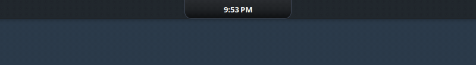<br><sub>A suggestion (switched on in the settings)</sub></p>

**Off as it comes:** the island suggests nothing, and learns nothing, until you switch suggestions on in Settings → Suggestions. Then, at a few moments, it may ask one short question ("The screen is being recorded. Hide notifications while it lasts?") with *Yes*, *Always* and *No*, and behind "⋯" *Not now* and *Turn this rule off*. From the answers it learns, per rule and per situation, whether to ask, to do it by itself (saying so, with an undo), or to stay quiet. Rules and counting only, on this computer: no network, no model.

The rules: Do Not Disturb before a calendar event, during a screen recording and in a Pomodoro focus round; pause media before a video meeting, when the microphone is used and when the headphones go away; power saving when the battery is low. **Settings → Suggestions** also has the pause between two suggestions, every rule with its switch and what it has learned, and "forget".

## Appearance, themes and the store

<!-- GIF: notch-colours.gif | The notch turns opaque black, then back to its own gradient; then it changes through the Aurora, Ocean and Sunset looks and back to Symbiot Black. | The notch's colours and four ready-made looks -->
<p align="center">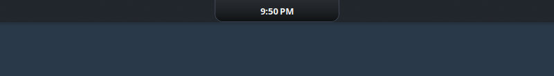<br><sub>The notch's colours and four ready-made looks</sub></p>
<!-- GIF: appearance-themes.gif | In the settings a ready-made look is chosen, a gradient is tuned and the notch changes at once; the look is exported as a file and added again. | Appearance: looks, a gradient, export and add -->

**Settings → Appearance**, from the top: the **layout** (Notch or Oval layout) with the notch's settings, **Full screen**, then the **look**. The notch takes its colours from the look (Notch → *Colour*).

- **Follow the system**: background, text and accent come from Plasma (its colour scheme or its Plasma style) and change with it at once.
- **Custom** (as it comes: Symbiot Black): ready-made looks (Oxygen Metallic, Breeze Dark, Breeze Light, Pure Glass, High Contrast and five gradients: Symbiot Black, Aurora, Sunset, Ocean, Midnight Blue), saved looks under a name, and *Fine tuning*: opacity, blur, horizontal position, **size (80–240 %)**, corner roundness, one colour or a gradient, the colours of controls and text, **button colour** (the fill of the buttons, tiles and cards: automatic, or a colour of your own kept readable), and for the oval layout the distance from the top, border and shadow. Every change shows on the island while the window is open.

**Theme files.** *Export Theme…* writes the look as one `*.islandtheme.json` file. *Add New…* takes one back, from a file or from the store. A theme is **data only**: at most 64 kB of JSON with known fields, no code, no QML, no pictures; anything else is refused, and a download whose checksum is not the catalog's is refused too. Themes you add are kept in `~/.local/share/dynamicisland/themes/`.

**The store** lists the `catalog/` folder of this repository. It makes a request only when you open its tab and when you press *Download*. Its address is one constant (`CATALOG_URL` in `contents/ui/ThemeFile.js`): the `catalog/` folder of this repository's `main` branch, as `raw.githubusercontent.com` serves it. Adding a theme of your own to the catalog: [CONTRIBUTING.md](CONTRIBUTING.md).

## The settings window

The gear at the top right of the open island opens it (the island's right-click menu too). The pages: **General**, **Appearance**, **Tabs**, **Activities**, then one page for each tab that has settings of its own (Weather, Controls, Tools, Habits, Calendar, Notes, AI, Cloud), shown in the sidebar only while that tab is on, then **Cat**, **Suggestions** and **Diagnostics**.

### Search and folded details

- **A search at the top of every page** finds any setting by its name, also one on a page that is not in the sidebar, in English or Turkish (without accents too), and opens it where it is.
- **Each page shows the few settings it is opened for** and folds the rest (*Details*, *Customize*, *Fine tuning*…); what does not apply to the layout or mode chosen is hidden. Long explanations are behind "?" buttons.
- **Response** (Settings → General): *Calm*, *Balanced* (as it comes) or *Lively* sets the hover and collapse delays and how long events and notifications stay; *Customize* sets each by hand.

### Tabs and language

<!-- GIF: language-switch.gif | While a screen recording shows on the notch, the island's language is switched from English to Turkish: "Screen recording" becomes "Ekran kaydı"; then back to English. | Language: the notch's text changes at once -->
<p align="center">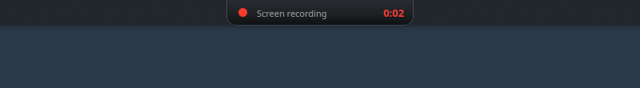<br><sub>Language: the notch's text changes at once</sub></p>
<!-- GIF: layout-reorder.gif | In Settings → Tabs a tab is dragged to another place and one is switched off; the island's tabs follow. | Tabs: ordering and hiding them -->

- **Settings → Tabs:** drag a tab by its handle to move it; its switch shows or hides it (at least one stays on). *Restore default order* puts them back. **Modules:** the parts inside a tab that can be switched. **System view:** Fixed or Dynamic.
- **Settings → General → Language:** like the system, Türkçe or English, for the island and its settings only, without restarting Plasma. **Time format** beside it: as the system's region writes it, or always 24 or 12 hours.

### Diagnostics and what is missing

- **Where a feature is**, a card says what it needs and is missing, why, how to get it (its page and a command to copy, per distribution), *Set the path by hand* and *Check again*. The island never runs that command. Without the native module every feature that needs it says it needs the full installation.
- **Settings → Diagnostics** lists this computer (the island's version, the session, Plasma, Qt, the native modules), every feature with what it needs, whether it was found, where it was looked for, its path and version, and a **command path** you can set by hand. *Copy diagnostics* puts the report on the clipboard for a bug report, without your user name, the computer's name or your home folder. *About* links to this page and to the issue form, and shows the tour again.
- **Feedback** at the end of Settings → Diagnostics: a few lines to the author, a way to answer if you want one, and the report if you tick it. *What is sent* shows exactly what leaves the computer; it is sent only with *Send*, through the project's relay to the author's Telegram (the bot's token is in the relay, never in the island). While the project has no relay address yet, the page links GitHub's issues instead.
- Commands are looked for on the desktop shell's `PATH`, in the folders installers put them into (`~/.local/bin`, `~/.cargo/bin`, npm's, nvm's, `/usr/local/bin`, `/snap/bin`, Flatpak's…) and as AppImages in `~/Applications`. More in the [reference](docs/REFERENCE.md#requirements-and-diagnostics).

## For developers: push your own activity

Any program can show an activity on the island over D-Bus (service, path and interface `org.phobby.DynamicIsland`, on the session bus).

<!-- GIF: island-push.gif | An activity named "Backup" appears on the notch with a progress ring that fills, then a green "done". | An activity pushed with island-push -->
<p align="center">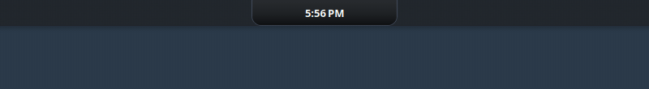<br><sub>An activity pushed with island-push</sub></p>

```bash
island-push --id build --title "Build" --progress 40 --icon run-build
island-push --id build --progress 80 --subtitle "linking…"
island-push --id build --done --status success
island-push --flash --title "Backup done" --icon document-save --color green
```

```bash
source /path/to/plasma-island/tools/notify-done.sh    # in ~/.bashrc or ~/.zshrc
notify-done make -j16          # on the island while it runs, then "Done" or "Failed"; the exit code is kept
```

| Method | |
|---|---|
| `Push(s id, a{sv} props)`, `Update(…)` | Create or change an activity |
| `Finish(s id, s status)` | End it: `success`, `error`, `cancel` or `""` |
| `Flash(a{sv} props)` | A passing event |
| `List() → as` | The ids that are active |
| signal `ActivityClicked(s id)` | The user clicked it |

`props`: `title`, `subtitle`, `icon`, `progress` (0–100, −1 for none), `color` (`red`, `green`, `blue`, `orange`, `purple`, `gray` or `#rrggbb`), `trailing`, `priority`, `category`, `timeout` (seconds), `duration` (ms, Flash only). A Go example and `busctl` are in the [reference](docs/REFERENCE.md#d-bus-api). Needs the native module; Settings → Activities switches the API off.

## Performance

<!-- PERF:BEGIN -->
| State | plasmashell | + KWin | + sensor service | Wakeups/s | Memory (RSS / PSS) |
|---|---|---|---|---|---|
| The same desktop without the island | 0.00 % | 0.00 % | – | 0 | 212 / 68 MB |
| The island with everything switched off | 0.01 % | 0.00 % | 0.07 % | 0 | 263 / 110 MB |
| Idle, shrunk to a dot | 0.12 % | 0.00 % | 0.19 % | 4 | 283 / 122 MB |
| Idle, the pill with the clock, no cat | 0.12 % | 0.00 % | 0.20 % | 4 | 282 / 120 MB |
| Idle with default settings (the cat asleep) | 0.40 % | 0.11 % | 0.19 % | 66 | 284 / 123 MB |
| The cat awake | 0.52 % | 0.17 % | 0.18 % | 107 | 283 / 123 MB |

CPU as per cent of **one** core (the machine has twelve threads), medians of three runs of two minutes each (two for "The same desktop without the island"), in an isolated session on a 60 Hz screen; "+ KWin" and "+ sensor service" are what the compositor and Plasma's sensor daemon use beside the shell ("–": the daemon was not running). Measured on one desktop PC (Ryzen 5 7500F, RTX 4060, Plasma 6.6.6 on Wayland): on yours it will differ, and on a display with a higher refresh rate whatever animates costs more. **The island's code has changed since these were taken, and they were not taken again.** The method, every scenario and how to take your own: [docs/PERFORMANCE.md](docs/PERFORMANCE.md).

**Not measured yet** (no figure is given for these):

- Music playing, with and without the ambient glow and the cat
- A look of your own: flat, glass with blur, a gradient
- A burst of notifications (200 in 80 s)
- An activity of the D-Bus API that changes every second
- A download being tracked
- Work in the background: the weather, two calendars and the notes, each asked once a minute
- Frames per second and frame times
- The long run of two hours: whether memory, threads or file descriptors grow
- Energy in watts
- Everything that needs a pointer: hovering, an open page, scrolling a list, stroking the cat
<!-- PERF:END -->

The notch and the full-screen modes came after these measurements: they are not in the table.

## Privacy and the network

There is **no telemetry**: the island reports nothing to anybody, and has no account. With the settings as they come, it makes **one network request a day**: it reads the newest version number of the island from this repository (`raw.githubusercontent.com`), and sends nothing but that request. Settings → General → *New versions of the island* → *Never look* switches it off; then there is no network request at all (checked with 0.1.0, which had no such check: 170 s of a fresh start with default settings under `strace`, no connection outside the computer). What each part does once you use it:

| Part | Talks to the network | Starts programs | Keeps on disk |
|---|---|---|---|
| The island itself, System, notifications, media | never | `pw-dump` (one, for the microphone/camera/recording indicators); Plasma's sensor service | its settings, in Plasma's own settings file and, so that they outlive the widget, in `~/.local/share/dynamicisland/settings.json` (a private calendar link you pasted is in both, as plain text; passwords and keys are in neither) |
| Ambient glow (off by default) | never | `pw-record` while music plays | nothing |
| Weather | Open-Meteo, **only after you choose a place**: the name you type goes to its search, the place's coordinates to its forecast (at most every 15 minutes) | none | the place, in the settings |
| Calendar | **only after you connect one**: the `.ics` links you pasted (every 5 minutes), or iCloud / Google for a connected account | the browser, once, for the Google sign-in | links and account names in the settings (a private link is a secret: it is stored as plain text there); passwords and tokens in KDE Wallet |
| Notes | **only for a connected app**: Joplin on this computer, Simplenote's servers, your Memos server; BetterNotes never | the `betternotes` command | tokens in KDE Wallet (the notes themselves stay in their apps) |
| AI (off by default) | **only when you send a question**, to the source you chose | `claude` or `agy` for those sources | keys in KDE Wallet; the chat only if you ask for it (`~/.local/share/dynamicisland/ai-chat.json`, readable by you only) |
| Cloud (off by default) | through `rclone`, for the remotes you set up: a listing when you open a folder, how full each cloud is every three hours | `rclone`; `dropbox status` if you use it | files you fetched, in `~/.cache/dynamicisland/cloud` (with a size limit) |
| Theme store | `raw.githubusercontent.com` (this repository's `catalog/`), **only when you open its tab** or press Download | none | themes you add, in `~/.local/share/dynamicisland/themes/` |
| Updates | never (it reads PackageKit's list on this computer) | none | nothing |
| The island's own new versions | `raw.githubusercontent.com` once a day for the version number (not with *Never look*); `github.com` for the archive, **only when an update is installed** | `sh`, `curl`, `tar` and the downloaded `install.sh`, only for an update | the download while it is installed, and the installer's last output, in `~/.cache/dynamicisland/update` |
| Download tracking | never | none (it reads the process list and the download folder) | nothing |
| Requirements, Diagnostics | never | none to look for a command (the native module looks at the folders); the Diagnostics page asks each command it found for its `--version`, without a shell | a command path you set by hand, in the settings; what was found is kept in memory for a while |
| Feedback (Settings → Diagnostics) | **only when you press Send**: what you wrote, a way to answer if you gave one, the island's version, language and session, and the diagnostics report if you ticked it, to the project's relay, which passes it on to the author's Telegram | none | nothing |
| Suggestions | never | none | what it learned, in `~/.local/share/dynamicisland/suggestions.json` |
| Habits, Pomodoro, Apps, Tools | never | the applications you start | their data, in the settings |
| Clipboard | never | none | nothing (the history is Klipper's) |
| D-Bus API | never | none | nothing |

Three more things worth knowing:

- **A page that is switched off does no work.** AI and Cloud are not even loaded while they are off. With every page and watcher switched off the island used 0.01 % of one core (a desktop without it: 0.00 %) and woke the processor less than once a second; it still holds about 50 MB of memory (see [Performance](#performance)).
- **What others write is shown as plain text.** A notification's title, a track's name, a file's or a network's name is never read as markup, so it cannot make the island fetch a picture from somewhere.
- **Programs are started without a shell**, each argument on its own; a password for a locked note goes to the program's standard input, never onto its command line.

## Troubleshooting

| | |
|---|---|
| The island does not appear | Restart plasmashell after installing (`systemctl --user restart plasma-plasmashell`), then add the widget. Logs: `journalctl --user -f \| grep -i -E "dynamicisland\|qml"` |
| Where is the widget I added? | The island is at the top of the screen; the widget's own icon shows only while the desktop is being edited (right click the desktop → *Enter Edit Mode*) |
| What is missing, and why? | **Settings → Diagnostics** lists what each feature needs, whether it was found, where it was looked for, the path and version, the session, Plasma and Qt. A feature whose requirement is missing says so where it is shown, with the command to copy (never run by the island). *Copy diagnostics* puts the report on the clipboard for a bug report, with your user name, the computer's name and your home folder left out |
| No blur, clicks beside the island do not pass through, pages say the native module is missing | The native module is not installed or plasmashell does not see it (installed from the KDE Store as a `.plasmoid`, or with `--no-native`): run `./install.sh` from a clone of this repository and restart plasmashell; Settings → Diagnostics shows the build packages for Kubuntu, Fedora and Arch. After a Plasma or Qt update, run it again |
| A command is installed but "not found" | The island looks on the desktop shell's `PATH`, in the folders installers put commands into (`~/.local/bin`, `~/.cargo/bin`, npm's, nvm's, `/usr/local/bin`, `/snap/bin`, Flatpak's…) and for AppImages in `~/Applications`. Anywhere else: Settings → Diagnostics → the command → *Command path* |
| The island hides (or does not) over a full-screen window | Settings → Appearance → *Full screen*. Only the window in front on the island's screen counts; a maximised one only with *For maximised windows*. Not on X11 |
| The notch covers my panel's clock or task buttons | Settings → Appearance → Notch → *Width*: narrower; or the *Oval layout* |
| Where exactly does the island take clicks? | Start plasmashell with `DYNAMICISLAND_DEBUG_REGION=1` in its environment: a red outline is drawn around the region (`systemctl --user set-environment DYNAMICISLAND_DEBUG_REGION=1`, restart plasmashell; `unset-environment` afterwards) |
| Typing into the island | The island never takes the keyboard by itself. It takes it when a field is clicked (Notes, AI, a reply) and gives it back with Escape; while it has it, the island stays open |
| Two islands, or two cats, when the island opens | The widget was added twice to one screen. Only the first one shows now; remove the other (its tooltip says that it is hidden) |
| BetterNotes is installed but "not found" | The island looks for the `betternotes` command (on the `PATH`, in `~/.local/bin`, an AppImage in `~/Applications`) and for its menu entry (also the Flatpak's). An AppImage kept elsewhere: give its path in Settings → Diagnostics, or `./BetterNotes-….AppImage install`. If the page says the native helper is missing, run `./install.sh` and restart plasmashell |
| BetterNotes: cannot save, cannot open, a locked note | Saving needs BetterNotes 0.1.13, opening a note in the app 0.1.14, locked notes 0.1.15. Quit a running older BetterNotes and start it again after updating. `betternotes --diagnostics` prints its own report |
| AI: Claude Code or Antigravity is installed and signed in, but the tab says "not found" (or only offers sources that need a key) | Up to 0.2.0 the island only looked on the desktop shell's `PATH` and in `~/.local/bin`; a `claude` installed with npm (nvm, a prefix of your own, bun, Volta…) is on a terminal's `PATH` only. 0.2.1 looks in those folders too, and needs its native module (`./install.sh`, or *Update* on the island). Still not found: set its path in Settings → Diagnostics, or `ln -s "$(command -v claude)" ~/.local/bin/claude` in a terminal, then open the tab again |
| Cloud: "rclone was not found" | Install rclone and add a remote in your own terminal (`rclone config`); the page shows the commands to copy and runs none of them |
| Weather shows nothing | It starts empty on purpose: *Choose a Location* on the page |
| A scroll turns the page instead of the list (or the other way round) | `QT_LOGGING_RULES="island.wheel.debug=true"` in plasmashell's environment logs who got each wheel step |
| Volume shows twice | Plasma's own popup and the island's: see the end of [Installing](#installing-updating-removing) |
| A keyboard shortcut to open the island | There is none of the island's own. Plasma's per-widget shortcut was not tried |
| The journal lists `qt.qml.usedbeforedeclared … IcsWorker.js` at every start | Harmless: they come from the code of the calendar library (ical.js) |
| To look at every pose of the cat | `DYNAMICISLAND_CAT_GALLERY=1` in plasmashell's environment opens a window with all of them |

## Known limits

- **Only one setup was tested:** Plasma 6.6.6 on Wayland with an NVIDIA card, one monitor. X11, other compositors' versions, several monitors and a screen too narrow for the cat's side were not tried. On X11 the notch goes to the top edge, but whether it stays over the panel is the window manager's matter, the full-screen choices other than *Hides* do nothing, and the click region also clips what is drawn, so the glow may be cut.
- **The newest parts were checked in an isolated session and off screen**, not on every real desktop: the tour on a real island, the settings window's sidebar hiding a tab's page, a whole keyboard pass through every page and a screen reader were not tried (see [docs/UI-AUDIT.md](docs/UI-AUDIT.md#not-verified-on-a-real-screen)).
- **The notch covers the panel under it**, and that part cannot be clicked; the island cannot see where a panel's widgets are (use *Width*).
- **Notifications appear twice**, Plasma's popup and the island's.
- **Dragging onto the island:** only the visible island takes a drag; dragging a file between the island and another program was written the way Qt offers it but could not be tried between two programs.
- **Download tracking:** tried with a Flatpak browser, `git clone`, `wget`, `curl`, `pip download`, `apt download` and a PackageKit download. `sudo apt update/install`, a Chromium browser, Firefox as a Snap and pausing inside the browser were not tried.
- **Calendar:** links are polled; an existing event cannot be edited from the island; an event may be pinned up to 20 s late. A calendar link may send up to 10 MB and take up to 30 seconds; one that is larger or slower is not read (the island says so and keeps showing its last good copy).
- **AI:** that Claude Code stays a question box rests on the command honouring its own options; the island checks what the command says about itself before every answer and stops it otherwise. The model servers other than Ollama were not installed here; a chat with a real key was tried against a stand-in, only a refused key against the real services.
- **Cloud:** there is no sync state for Google Drive, OneDrive or Nextcloud through rclone; Syncthing's and Dropbox's were tried against stand-ins.
- **Updates** count PackageKit's packages (apt, dnf); Flatpak updates are not counted.
- **KDE Connect** has no "call ended" signal: the call activity ends when its notification closes.
- **Bluetooth headphones** give one battery value, not left, right and case.
- **The D-Bus API** belongs to one island at a time (the first that registers); a second "dynamic island" widget beside this one overlaps it.

The long list, with what was tried for each part, is in the [reference](docs/REFERENCE.md#known-limitations).

## Contributing and security

- **Code, tests, a theme for the store:** [CONTRIBUTING.md](CONTRIBUTING.md). `tools/run-tests` runs every check that needs no running island.
- **A security problem:** [SECURITY.md](SECURITY.md). Please do not open a public issue for it.
- **How it is built:** [docs/ARCHITECTURE.md](docs/ARCHITECTURE.md). Every feature in detail: [docs/REFERENCE.md](docs/REFERENCE.md). What changed: [CHANGELOG.md](CHANGELOG.md). How the settings were simplified: [docs/UI-AUDIT.md](docs/UI-AUDIT.md).

<!-- TODO(owner): roadmap. Only what the owner has decided goes here. -->

## Licence and thanks

The island is free software under the **GNU General Public License, version 2 or (at your option) any later version** (`GPL-2.0-or-later`); its text is in [LICENSE](LICENSE).

It stands on the work of others; the full list with every licence is in [docs/CREDITS.md](docs/CREDITS.md):

- [KDE Plasma](https://kde.org/plasma-desktop/) and Qt, which it is a widget of.
- [Lucide](https://lucide.dev) (ISC; some of its icons come from Feather, MIT): the weather pictures and the AI tab's sparkles.
- [ical.js](https://github.com/kewisch/ical.js) (MPL-2.0): reading calendar files.
- [Open-Meteo](https://open-meteo.com): weather data, licensed under [CC BY 4.0](https://creativecommons.org/licenses/by/4.0/).
- [Simple Icons](https://simpleicons.org) (CC0): the marks that label the Apple and Google calendar options and the Joplin and Simplenote sources. They are trademarks of their owners.
- [BetterNotes](https://github.com/thebanri/BetterNotes) (MIT): its icon, and thanks for the command-line interface the Notes tab talks to.
- The music and covers in the clips were made for this project by `tools/demo/make-media` and are free to use (CC0); every name, message and event in them is made up ([docs/CREDITS.md](docs/CREDITS.md#the-clips-in-the-readme)).
