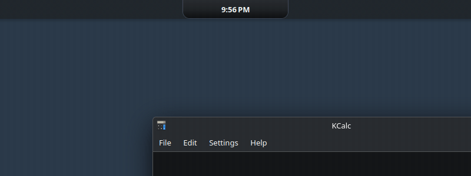
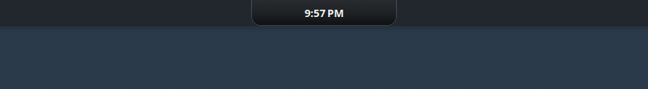

<!-- Bu dosyada hâlâ açık olanlar docs/RELEASE-CHECKLIST.md içinde listelidir: ana video, henüz kaydedilmemiş klipler, yol haritası. -->

# KDE Plasma 6 için Dinamik Ada

KDE Plasma masaüstünün üst kenarıyla birleşen bir çentik: müzik, indirmeler, zamanlayıcılar, aramalar ve bildirimler onda görünür, üzerine gelince sayfaları aşağıya açılır.

[](#lisans-ve-teşekkürler)


[English](README.md) · **Türkçe**

<!-- TODO(owner): ana video buraya (docs/RELEASE-CHECKLIST.md). -->

<!-- GIF: notch-states.gif | Ekranın üstünde, koyu bir üst panelin üzerindeki çentik saati gösteriyor, yanında kedi; bir mesaj geliyor ve çentik genişleyip göndereni ve ilk satırı gösteriyor; sonra dolan ilerleme halkasıyla bir derleme "Done" ile bitiyor. | Çentik: boşta, bir bildirim, bir etkinlik -->
<p align="center"><br><sub>Çentik: boşta, bir bildirim, bir etkinlik</sub></p>

**Tek cümleyle:** ekranın üstüne, dizüstü bilgisayarlardaki ya da telefonlardaki gibi küçük siyah bir çentik koyan ve onu o an olup bitenle (bir şarkı, bir indirme, bir zamanlayıcı, bir arama, bir bildirim) dolduran bir Plasma widget'ı; üzerine gelince müzik, sistem, hava durumu, takvim, notlar, hızlı ayarlar ve daha fazlası için sayfalara açılır. Her parça kapatılabilir ve siz bir şey bağlamadıkça hiçbir yere hiçbir şey gönderilmez.

Klipler arayüz İngilizceyken kaydedilmiştir; ada Türkçe de konuşur (Ayarlar → Genel → Dil, [klibi](#sekmeler-ve-dil) aşağıda).

## İçindekiler

- [Yenilikler](#yenilikler)
- [Çentik](#çentik): [üst panelle](#üst-panelle) · [Çentik ayarları](#çentik-ayarları) · [Tam ekran](#tam-ekran) · [Nokta modu](#nokta-modu) · [Durumlar](#durumlar)
- [Öne çıkanlar](#öne-çıkanlar)
- [Gereksinimler](#gereksinimler)
- [Kurulum, güncelleme, kaldırma](#kurulum-güncelleme-kaldırma)
- [İlk adımlar](#i̇lk-adımlar)
- [Sekmeler](#sekmeler): [Etkinlikler](#etkinlikler) · [Medya](#medya) · [Sistem](#sistem) · [Hava Durumu](#hava-durumu) · [Bildirimler](#bildirimler) · [Kontroller](#kontroller) · [Uygulamalar](#uygulamalar) · [Araçlar](#araçlar) · [Alışkanlıklar](#alışkanlıklar) · [Takvim](#takvim) · [Notlar](#notlar) · [Yapay Zeka](#yapay-zeka) · [Bulut](#bulut) · [Pano](#pano)
- [Kedi](#kedi)
- [Anlık olaylar](#anlık-olaylar): [ekran kaydı](#ekran-kaydı-ve-paylaşımı) · [bildirimler](#bir-bildirim-geldiğinde) · [indirmeler](#i̇ndirmeler-ve-dosya-aktarımları) · [gelen arama](#gelen-arama) · [gizlilik noktaları](#gizlilik-noktaları) · [öneriler](#öneriler)
- [Görünüm, temalar ve mağaza](#görünüm-temalar-ve-mağaza)
- [Ayarlar penceresi](#ayarlar-penceresi): [arama](#arama-ve-katlanan-ayrıntılar) · [sekmeler ve dil](#sekmeler-ve-dil) · [Tanılama](#tanılama-ve-eksik-olanlar)
- [Geliştiriciler için: kendi etkinliğini gönder](#geliştiriciler-için-kendi-etkinliğini-gönder)
- [Performans](#performans) · [Gizlilik ve ağ](#gizlilik-ve-ağ) · [Sorun giderme](#sorun-giderme) · [Bilinen sınırlar](#bilinen-sınırlar) · [Katkı ve güvenlik](#katkı-ve-güvenlik) · [Lisans ve teşekkürler](#lisans-ve-teşekkürler)

## Yenilikler

0.2.2'den bu yana gelenler `main` dalındadır ve onun bir klonundan yapılan kurulumla gelir ([Kurulum](#kurulum-güncelleme-kaldırma)). **Henüz etiketli bir sürümde değiller:** kurulu bir 0.2.2 adasındaki *Güncelle*, bir sonraki sürüm yayımlanana kadar bunları getirmez. Hepsinin listesi [CHANGELOG](CHANGELOG.md#unreleased) içindedir (İngilizce).

| | |
|---|---|
| **Geldiği gibi çentik** | Ada, ekranın üst kenarına ve üst panelin üzerine birleşik, **Symbiot Siyahı** gradyanında ve ince, soluk gri bir kenarlıkla gelir. Önceki sürümlerin yuvarlak adası *Oval düzen*dir (Ayarlar → Görünüm → Düzen). |
| **Tam ekranda dört seçenek** | Tam ekran bir pencerenin üzerinde ada olduğu gibi kalır, gizlenir, kenarda ince bir şerit bırakarak yukarı çekilir ya da küçük bir çıkıntıya küçülür; son ikisi, isterseniz, bir süre hiçbir şey olmayınca masaüstünde de. [Ayrıntılar](#tam-ekran) |
| **Hiçbir şey görünmeden, kenarda bir ışık** | Yukarı çekilmişken şerit 0 px olabilir: adanın hiçbir yeri çizilmez, fareyi üst kenara itmek yine de onu açar. Fare oraya gelince kenarda yumuşak bir ışık adanın yerini gösterir; adanın vurgusu, sistemin vurgusu ya da kendi renginiz. |
| **İleri geri yok** | Çentiğe doğru sürüklenen bir pencere artık onu inip kalkmaya zorlamaz: pencere bırakılınca, çentiğin dinlenme boyutuna göre bir kez bakılır. |
| **Çentiğin genişliği** | Otomatik ya da 1200 px'e kadar daha dar veya daha geniş ayarlanır; böylece yanındaki panel öğeleri tıklanabilir kalır, açık ada da onu izleyebilir. |
| **%240'a kadar boyut** | Ekranın içinde tutulur; ayarlar ekran kenarına ulaşıldığını söyler. |
| **Düğmelerin renkleri** | Adanın düğmeleri, kutucukları ve kartları için tek bir düğme rengi; Kontroller düğmeleri her biri kendi renginde ya da hepsi tek renkte. |
| **Gereksinimler kendini söyler** | Bir özelliğin ihtiyaç duyduğu bir şey eksikse (yerel modül, `rclone`, `btop`, BetterNotes, `claude`…) ne olduğunu, nedenini ve Kubuntu, Fedora ya da Arch için kopyalanacak komutu söyler. Ada o komutu asla çalıştırmaz. |
| **Ayarlar → Tanılama** | Her özelliğin neye ihtiyaç duyduğu, bulunup bulunmadığı ve nerede, oturum, Plasma ve Qt, elle verilen bir komut yolu; hata bildirimi için adınız ve ev klasörünüz olmadan *Tanılama çıktısını kopyala*. |
| **Daha sade ayarlar** | 18 yerine 15 sayfa, katlanmış ayrıntılar, her ayarda arama ve *Tepki*: gecikmeler için Sakin, Dengeli ya da Canlı. Hiçbir ayar kaldırılmadı ya da yeniden adlandırılmadı. |
| **Kısa bir tanıtım** | Yeni bir adanın ilk açılışında üç adım: düzen, sekmeler, bu bilgisayarda neyin olduğu. |
| **Saat biçimi** | Saat, sistemin bölgesinin yazdığı gibi ya da her zaman 24 veya 12 saat. |
| **Tutamaç yolda durmaz** | Widget'ın masaüstündeki küçük simgesi yalnızca masaüstü düzenlenirken görünür. |
| **Ayarlardan geri bildirim** | Ayarlar → Tanılama → *Geri bildirim*: geliştiriciye birkaç satır, saatte en fazla üç kez; işaretlerseniz rapor da. [Ayrıntılar](#tanılama-ve-eksik-olanlar) |

**0.2.2 ya da daha eskisinden güncellemek** seçimlerinizi korur: daha önce çalışmış bir ada sahip olduğu düzeni korur (o anahtarın olduğu bir derlemede çentiği açmadıysanız oval düzeni) ve çentiğin geldiğini bir kez söyler; tanıtım ona gösterilmez. Hiç değiştirmediğiniz görünüm ayarları yeni varsayılanları alır, yani geldiği gibi bırakılmış bir görünüm Symbiot Siyahı olur: Ayarlar → Görünüm içindeki *Sistemi takip et* eskisini geri getirir.

## Çentik

Ada, dizüstü ekranlarındaki çentik gibi ekranın üst kenarına birleşik tek bir parçadır: kenarla birleştiği yerde köşesiz ve düz, yalnızca alt köşeleri yuvarlak. Üst panelin (kendini gizleyen bir panelin de) üzerinde durur ve aşağıya doğru büyür: bir bildirim, bir etkinlik ya da üzerine gelince sayfaları için. İmleci üstündeki ekran kenarına dayamak da onu açar: en üst piksel sırası da imleci alır.

<!-- GIF: notch-hover.gif | İmleç çentiğin üzerine geliyor ve çentik aşağıya doğru sayfalarına açılıyor; imleç uzaklaşınca geri küçülüyor; imleç çentiğin üstündeki ekran kenarına dayanıyor ve yeniden açılıyor. | Çentik: üzerine gelme, kapanma, kenara dayama -->

**Symbiot Siyahı** gradyanıyla (koyu gri `#292c30`, `#202326` ve siyaha yakın `#0e1012`) ve ince, soluk gri bir kenarlıkla (`#4c566a`, %70) gelir. Önceki sürümlerin yuvarlak adası hâlâ vardır: **Ayarlar → Görünüm → Düzen → Oval düzen**.

### Üst panelle

- **Çentik altındakini örter** ve panelin o kısmına tıklanamaz; çentiğin yanında panel tıklamaları eskisi gibi alır. Panelinizin ortasında saat ya da görev düğmeleri varsa çentiği **Genişlik** ile daraltın (Ayarlar → Görünüm, düzenin altında): ada, panelin öğelerinin nerede olduğunu okuyamaz. Bildirimler ve açık ada, gösterildikleri sürece daha geniştir.
- **Yüksekliği** üst paneli izler (panel gizliyken de) ya da elle ayarlanır. Üst panel yoksa yine üst kenarda, adanın kendi yüksekliğinde durur.
- **Kedi** çentiğin yanında, panelin üzerinde durur.
- **Koyu bir panel**, çentiğin ekranın bir parçası gibi göründüğü yerdir: buradaki kliplerde Breeze Dark ve opak, 32 px'lik bir panel kullanıldı.

### Çentik ayarları

**Ayarlar → Görünüm → Düzen: Çentik.** İlk üçü sayfadadır; gerisi *Çentik ayrıntıları* altında katlıdır.

| Ayar | Ne yapar |
|---|---|
| Renk | *Adanın renkleri (Görünüm)*: görünümün renkleri ya da gradyanı, opak hale getirilmiş (geldiği gibi); *Siyah*: açık renk metinle opak siyah; *Adanın görünümü (Görünüm)*: malzemesi, opaklığı ve bulanıklığı da |
| Ekran | *Üst panelin olduğu ekran* (geldiği gibi) ya da *Birincil ekran*. Aynı anda tek çentik |
| Genişlik | *Otomatik* (gösterdiği kadar geniş) ya da %100 boyutta dardan 1200 px'e kadar; ekranı asla aşmaz |
| Önizleme | Ayrıntıların başında çentik küçük ya da nokta olarak |
| Çentik kenarlığı | *Çentiğin kenarlığını göster* (geldiği gibi açık): kalınlık 1–8 px, renk, opaklık %0–100. Yanlar ve alt köşeler boyunca çizilir, ekran kenarı boyunca asla |
| Üst köşeler | *Kenarla birleştiği yeri yumuşat*: yana doğru iki küçük kıvrım (geldiği gibi kapalı) |
| Yükseklik | *Üst panelinki* (geldiği gibi) ya da *Elle* (24–72 px) |
| Açıkken | *Açık adadan genişse, açılınca da bu genişlikte olsun* (geldiği gibi açık) |
| Tam ekran | *Yukarı çekilir* ya da *Küçülür* seçiliyken ([aşağıda](#tam-ekran)): altına uzanan bir pencerede de, ve orada açıkken boyutu ile genişliği |
| Kedi | *Çentik düzeninde kediyi gizle* |

Çentiğin kullanmadıkları: üstten uzaklık, *Üst panellerin altına yerleş* ve görünümün kendi kenarlığı ile gölgesi (bunlar oval düzenindir). Ayrıntılar [başvuru belgesinde](docs/REFERENCE.md#layout-notch--oval-layout) (İngilizce).

### Tam ekran

**Ayarlar → Görünüm → Tam ekran**, iki düzen için de. Bir pencere ekranını doldururken ada ne yapar:

| Seçenek | Ne olur | Nasıl geri gelir |
|---|---|---|
| Olduğu gibi kalır | Hiçbir şey değişmez | – |
| **Gizlenir** (geldiği gibi) | Kaybolur | Pencere tam ekrandan çıkınca |
| Yukarı çekilir, ince bir şeridi görünür | Olduğu boyutta, yalnızca şerit görünene kadar kenara çekilir (0–12 px, geldiği gibi 2; 0: hiçbir şey); yanındaki tıklamalar pencereye gider | İmleç üst kenarda kısa bir süre durunca; kenar ışığı orada olduğunu gösterir |
| Küçük bir çıkıntıya küçülür | Kenarda küçük bir çıkıntıya çekilir | İmleç çıkıntının üzerine gelince |

- **Ayrıca:** *Büyütülmüş pencerelerde* (geldiği gibi kapalı: yalnızca gerçek bir tam ekran pencere sayılır, hangi uygulama olursa olsun: bir video, tarayıcıda F11, bir uçbirim, bir oyun). *Masaüstünde boştayken de, şu süre sonra:* 2–300 sn (geldiği gibi 10, geldiği gibi kapalı): yukarı çekilme ya da küçülme boş masaüstünde de olur; bir bildirim, canlı bir etkinlik ya da açmak onu hemen geri getirir.
<!-- GIF: window-dodge.gif | Bir hesap makinesi penceresi çentiğin altına taşınıyor ve çentik üst kenarın ardına çekiliyor; imleç kenara geliyor, orada yumuşak mavi bir ışık beliriyor ve ada açılıyor; imleç gidince ada kapanıp yeniden yukarı çekiliyor; pencere aşağı taşınınca çentik geri geliyor. İmleç çizilmemiştir. | Çentiğin altında bir pencere, kenar ışığı -->
<p align="center"><br><sub>Çentiğin altında bir pencere, kenar ışığı</sub></p>

- **Sayfada:** *Görünen parça* (0–12 px), *Kenar ışığı* (*Fare oraya gelince parlasın*, geldiği gibi açık) ve rengi: *Adanın görünümü*, *Vurgu rengi* (sistemin, geldiği gibi) ya da *Kendi rengim*. Hiçbir şey görünmüyor ve ışık kapalıysa sayfa onu nasıl açacağınızı söyler.
- **Tam ekran ayrıntıları:** *Dene* ve *Işığı önizle* düğmeli bir önizleme, ışığın yoğunluğu (%10–100, 60), *Açılma bölgesi*: adanın daha azı göründüğünde onu açan, en üst satırdan aşağı kaç satır olduğu (1–8 px, 1; alttaki pencerenin bu satırları tıklama almaz), imlecin açmadan önce ne kadar duracağı (0–1000 ms, 150), bu bölgenin ne kadar geniş olduğu ve gelen bir aramanın onu açıp açmayacağı. Bir kayıt, mikrofon ya da kamera, kritik bir uyarı ve bir arama şeridi, hiçbir şey görünmüyorsa ışığı renklendirir.
- **Ne sayılır:** yalnızca öndeki pencere, adanın kendi ekranında ve gösterilen masaüstü ile etkinlikte. Başka bir sanal masaüstündeki tam ekran pencere hiçbir şey yapmaz. Çentiğin altına uzanan bir pencere (çentiğin kendi ayarlarında, geldiği gibi açık) çentiğin dinlenme boyutuna göre ölçülür, pencereler bir an hareketsiz kalınca sayılır (biri sürüklenirken değil) ve çentikten birkaç piksel uzaklaşınca sayılmaz olur. Fareyle açılmış ada, böyle bir pencere gelince açık kalır.
- **Yalnızca Wayland.** Başka yerde ekranı dolduran pencere adanın üstüne biner ve ada olduğu gibi kalır. Ayrıntılar: [başvuru belgesi](docs/REFERENCE.md#full-screen-mode) (İngilizce).

### Nokta modu

Çentiğe tıklamak onu yoldan çekilsin diye bir noktaya küçültür (kenarda küçük bir yarım daire, 15 px; ayarlarda 10–28); noktaya tıklamak çentiği geri getirir. Panelin geri kalanındakiler tıklanabilir kalır.

<!-- GIF: dot-mode.gif | Bir tıklama saatli çentiği üst kenarda küçük bir yarım daireye küçültüyor; noktaya bir tıklama çentiği geri getiriyor. İmleç çizilmemiştir. | Nokta modu -->
<p align="center"><br><sub>Nokta modu</sub></p>

Noktanın ortası ne olduğunu söyler: mikrofon, kamera ya da ekran kullanımı için turuncu, yeşil ya da kırmızı; canlı etkinlik (nabız gibi atar) ya da bekleyen bildirimler için vurgu rengi. Nokta halindeyken bildirimler ve olaylar sonraya saklanır (ya da gösterilip noktaya dönülür: *Nokta modunda olaylar*). Gelen arama, alarm ve düşük pil, siz kapatmadıkça her durumda adayı açar.

**Ayarlar → Genel → Nokta modu:** açık/kapalı; *Nokta kipi ayrıntıları* altında: başlangıç durumu (bırakıldığı gibi, her zaman çentik, her zaman nokta), nokta boyutu, noktanın üzerine gelince adanın açılıp açılmayacağı, nokta modunda olaylar, kritik olaylarda her zaman açılma.

### Durumlar

| Durum | Ne zaman | Ne görürsünüz |
|---|---|---|
| Boşta | Hiçbir şey olmuyor | Saat |
| Canlı etkinlik | Bir şey sürüyor (müzik, zamanlayıcı, aktarım, kayıt, arama) | Solda simgesi ya da kapağı; sağda süresi, değeri ya da ilerleme halkası |
| Ayrık | İki şey aynı anda sürüyor | İlki çentikte, ikincisi yanında kendine ait küçük bir çentikte |
| Bildirim | Bir bildirim geldiğinde | Uygulama, başlık, ilk satır. Tıklama varsayılan eylemi çalıştırır, orta tıklama kapatır |
| Anlık olay | Ses, parlaklık, şarj, Bluetooth, Caps Lock, Wi-Fi… | Birkaç saniye (geldiği gibi 3 sn) daha geniş bir çentik |
| Öneri | Bir kuralın anı (geldiği gibi kapalı, bkz. [Öneriler](#öneriler)) | Bir cümle ve düğme olarak yanıtları |
| Açık | Üzerine gelme ya da nokta modu kapalıyken tıklama | Aşağıdaki sayfalar |
| Gizlilik noktaları | Mikrofon ya da kamera kullanımda | Çentiğin yanında, her durumda turuncu ya da yeşil bir nokta |
| Nokta | Nokta modunda bir tıklamadan sonra | Kenarda küçük bir yarım daire |
| Yukarı çekilmiş / çıkıntı | Tam ekran bir pencerenin üzerinde, [seçildiyse](#tam-ekran) | Kenarda ince bir şerit (ya da hiçbir şey ve fare gelince ışık) veya küçük bir çıkıntı |

Birden fazla şey sürerken hangisinin öne geçeceği yeniden sıralayabileceğiniz bir listedir (Ayarlar → Etkinlikler → *Öncelik*): gizlilik, arama, ekran kaydı, anlık olaylar, zamanlayıcı, aktarımlar, medya.

## Öne çıkanlar

| | |
|---|---|
| **Canlı etkinlikler** | Kapağıyla müzik, zamanlayıcı, ilerlemesiyle bir aktarım, ekran kaydı, arama. İki şey aynı anda sürerse çentik ikiye ayrılır. |
| **Anlık olaylar** | Ses, parlaklık, şarj, Bluetooth, Caps Lock, yeni bildirim: birkaç saniye, sonra önceki haline döner. |
| **Sekmeler** | Üzerine gelince açılır: Medya, Sistem, Hava Durumu, Bildirimler, Kontroller, Uygulamalar, Araçlar, Alışkanlıklar, Takvim, Notlar, Pano ve (siz açana kadar kapalı) Yapay Zeka ile Bulut. |
| **Bir kedi** | Çentiğin yanında: uyur, müzikte kulaklık takar, okşanmayı sever. Kapatılabilir. |
| **Sizin görünümünüz** | Geldiği gibi Symbiot Siyahı; dokuz hazır görünüm daha, kendi renkleriniz ya da gradyanınız, ya da Plasma'nın renkleri. Görünümler dosya olarak dışa aktarılıp paylaşılır. |
| **Yolda durmaz** | Tam ekranda gizlenir, yukarı çekilir ya da küçülür; bir tıklama onu noktaya çevirir. |
| **Neye ihtiyacı olduğunu söyler** | Eksik bir program ya da modül, önemli olduğu yerde, kopyalanacak komutla adıyla söylenir; Ayarlar → Tanılama hepsini listeler. |
| **Betiklenebilir** | Her program küçük bir D-Bus API'siyle (`island-push`) kendi etkinliğini gösterebilir. |
| **Varsayılan olarak gizli** | Telemetri yok. Ayarlar geldiği gibiyken tek istek, günde bir kez en yeni sürüm numarasına bakmaktır; bkz. [Gizlilik ve ağ](#gizlilik-ve-ağ). |

QML ile yazılmış bir Plasma widget'ıdır (plasmoid); QML'in erişemediği kısımlar için isteğe bağlı küçük bir yerel modül (C++) vardır. Her parça kapatılabilir.

## Gereksinimler

| | |
|---|---|
| Masaüstü | KDE Plasma 6 (widget en düşük Plasma API 6.0 bildirir) |
| Test edildiği ortam | Kubuntu 26.04, Plasma 6.6.6, Qt 6.10.2, **Wayland** üzerinde KWin, NVIDIA sürücüsü. Başka hiçbir ortam denenmedi. |
| X11 | **Denenmedi.** Çentik o zaman üst kenara gider, ama panelin üzerinde kalıp kalmadığı pencere yöneticisine bağlıdır ve *Gizlenir* dışındaki tam ekran seçenekleri bir şey yapmaz (bkz. [Bilinen sınırlar](#bilinen-sınırlar)). |
| Yerel modülü derlemek için | `cmake`, `extra-cmake-modules`, Qt 6.5 ya da daha yeni geliştirme dosyaları (Core, Gui, Qml, DBus, Network, Sql), `libkf6windowsystem-dev`. Ayarlar → Tanılama Kubuntu, Fedora ve Arch için paket adlarını gösterir |
| Çalışma zamanında | Mikrofon, kamera ve ekran kaydı göstergeleri için PipeWire'ın `pw-dump` aracı (Ubuntu'da `pipewire-bin` paketi) |

Yerel modül olmadan widget yine çalışır; ona ihtiyaç duyan her özellik bozulmak yerine gösterildiği yerde bunu ve neyin kurulacağını söyler: birincil olmayan bir ekranda çentik, biçimli bulanıklık, adanın yanındaki tıklamaların alttaki pencereye geçmesi, kayıt, mikrofon ve kamera göstergeleri, kilit açma, KDE Connect aramaları, güncelleme sayısı, D-Bus API'si, takvim hesapları ve tüm parola ve anahtarlar (KDE Cüzdan'da durur), tema dosyaları, indirme takibi, program başlatan düğmeler, Bulut ve Yapay Zeka yardımcıları.

**İsteğe bağlı programlar.** Hiçbiri zorunlu değil; her biri bir şey ekler.

| Program | Ne ekler |
|---|---|
| [rclone](https://rclone.org) | Bulut sekmesi: rclone uzaklarınız (Google Drive, OneDrive, Dropbox, WebDAV…) |
| [BetterNotes](https://github.com/thebanri/BetterNotes) 0.1.13+ | Bu bilgisayarda, hesapsız notlar (bir notu uygulamada açmak için 0.1.14, kilitli notlar için 0.1.15) |
| Joplin (masaüstü), bir Simplenote hesabı, bir Memos sunucusu | Notlar sekmesinde onların notları |
| KDE Connect | Telefon pili, aramalar, telefondan gelen bildirimler, "telefonumu bul" |
| Claude Code (`claude`), Antigravity (`agy`) | Yapay Zeka sekmesi bunlar üzerinden, tüm araçları kapalı olarak yanıt verir |
| Ollama, LM Studio, llama.cpp, Jan, KoboldCpp | Yapay Zeka sekmesi bu bilgisayardaki bir modelden yanıt verir |
| `btop` 1.4+ | Bir Sistem kartına tıklamak o ölçünün grafiğini uçbirimde açar |
| Spectacle, Discover, bir kamera uygulaması | Kontroller sekmesindeki ilgili düğmeler |
| PackageKit | Bekleyen güncelleme sayısı |

## Kurulum, güncelleme, kaldırma

```bash
git clone https://github.com/Phobby/plasma-island.git
cd plasma-island
./install.sh               # widget, yerel modül ve island-push
systemctl --user restart plasma-plasmashell
```

Ya da hepsi, kopyalayıp yapıştırılacak tek satır olarak:

```bash
git clone https://github.com/Phobby/plasma-island.git && cd plasma-island && ./install.sh && systemctl --user restart plasma-plasmashell
```

`install.sh` parola istemez ve hiçbir şey indirmez: widget'ı `kpackagetool6` ile kullanıcınıza kurar, yerel modülü CMake ile derleyip `~/.local/lib/qml` altına koyar, `island-push` aracını `~/.local/bin` altına koyar ve modülü plasmashell'e görünür kılar (`~/.config/environment.d/90-dynamicisland.conf` içinde `QML_IMPORT_PATH`). Yeniden çalıştırmak yerinde günceller. `main` dalının bir klonu [Yenilikler](#yenilikler) bölümündeki her şeyi getirir.

| | |
|---|---|
| Yalnızca widget, yerel modül olmadan | `./install.sh --no-native` (modül isteyen özellikler o zaman bunu söyler) |
| Elle | `kpackagetool6 -t Plasma/Applet -i org.phobby.dynamicisland` (güncellemek için `-u`) |
| Güncelleme | Yeni sürüm çıkınca ada sorar: *Güncelle* onu indirir, derler, kurar ve kabuğu yeniden başlatır (aşağıya bakın). Elle: `git pull`, sonra `./install.sh` ve plasmashell'i yeniden başlatın |
| Kaldırma | `./install.sh --remove`, sonra plasmashell'i yeniden başlatın |

**Güncelleme her şeyi korur.** Güncelleme yalnızca widget'ın dosyalarını ve yerel modülü değiştirir; önce hiçbir şey kaldırılmaz. Ayarlarınız, bağlı hesaplarınız, temalarınız ve verileriniz, hangi yolla güncellerseniz güncelleyin, olduğu gibi kalır. Yeri ya da anlamı değişen ayarlar bir kez, kendiliğinden güncellenir (ayarların kendine ait bir sürümü vardır); bunun neyi koruduğu için [Yenilikler](#yenilikler) bölümüne bakın.

<details><summary>Adadan ya da komutlarla güncelleme</summary>

- **Adadan (0.2.0 ve sonrası).** Ada günde bir kez bu depodan en yeni sürüm numarasını okur. Daha yenisi varsa adada sorar: *Güncelle* o sürümü indirir (GitHub'daki etiketin arşivi), derler, kullanıcınız için kurar ve masaüstü kabuğunu yeniden başlatır; bu sırada ada ne kadar ilerlediğini gösterir. Ayarlar → Genel → *Adanın yeni sürümleri* ile *Hiç bakma*, *Bana sor* (geldiği hali) ve *Kendiliğinden kur* (o zaman yalnızca kabuk yeniden başlamadan önce sorar) arasında seçilir. Kurulum için yerel modül ve `curl` gerekir; modül yoksa ada yalnızca yeni sürüm olduğunu söyler.
- **Elle, komutlarla.** Hangi sürüm kurulu, en yenisi hangisi (0.2.2 ve sonrası):

  ```bash
  sh ~/.local/share/plasma/plasmoids/org.phobby.dynamicisland/contents/scripts/island-update.sh --check
  ```

  `installed 0.2.1` ve `newest 0.2.2` yazdırır. Daha eski bir adada: `grep Version ~/.local/share/plasma/plasmoids/org.phobby.dynamicisland/metadata.json` (en yenisi bu sayfanın başındaki rozettedir).

  En yeni sürüme güncelleme, klonladığınız klasör olmadan (0.2.0 ve sonrası); indirir, derler, kurar ve kabuğu yeniden başlatır:

  ```bash
  sh ~/.local/share/plasma/plasmoids/org.phobby.dynamicisland/contents/scripts/island-update.sh latest --restart
  ```

  Klonladığınız klasörde (güncelleyicisi olmayan 0.1.0'dan tek yol ve `main` dalındakileri yayımlanmadan önce almanın yolu):

  ```bash
  git pull && ./install.sh && systemctl --user restart plasma-plasmashell
  ```

</details>

**Masaüstünden kaldırılıp geri eklenen ada olduğu gibi gelir** (0.2.2 ve sonrası, yerel modülle). Plasma, widget kaldırılınca ayarlarını siler; ada bu yüzden ayarları `~/.local/share/dynamicisland/settings.json` dosyasında da tutar (yalnızca siz okuyabilirsiniz) ve yeni eklenen widget onları bir kez oradan okur. Sıfırdan başlamak için widget'ı eklemeden önce o dosyayı silin (ya da ayarlarda *Varsayılanlar*'ı kullanın).

Kaldırma verilerinizi yerinde bırakır: `~/.local/share/dynamicisland/` (ayarlarınızın kopyası, eklediğiniz temalar, önerilerin öğrendikleri, saklanan Yapay Zeka sohbeti), `~/.cache/dynamicisland/` (buluttan alınan dosyalar), KDE Cüzdan'daki "Dynamic Island" klasörü ve widget'ı masaüstünden kaldırana kadar Plasma'nın kendi dosyasındaki ayarları. Gitmesini istiyorsanız elle silin.

**Ekrana yerleştirme.** Ada kendi başına bir penceredir, bu yüzden widget'ın nereye eklendiği önemli değildir:

1. Masaüstüne (ya da düzenleme kipindeki bir panele) sağ tıklayın → araç takımı (widget) ekleme penceresini açın (*Araç Takımları Ekle…*) → "Dinamik Ada".
2. Ada o ekranın üst ortasında belirir. Widget'ın kendisi yalnızca küçük bir tutamaç simgesidir ve masaüstü düzenlenirken görünür (taşımak ya da kaldırmak için).
3. Çentik üst kenarla birleşir ve üst panelin üzerinde durur. Değiştirmek ya da oval düzeni seçmek için: Ayarlar → Görünüm → Düzen.

Plasma'nın kendi ses açılır penceresi adanınkinin yanında görünmeye devam eder. Yalnızca birini bırakmak için: adada Ayarlar → Etkinlikler → "Ses, parlaklık ve ses çıkışı" seçeneğini kapatın ya da Sistem Ayarları → Ses içinden ses açılır pencerelerini kapatın. (Plasma'da parlaklık açılır penceresini kapatan bir ayar yok.)

## İlk adımlar

- **Tanıtım.** Yeni bir adanın ilk açılışı üç kısa adım gösterir: çentik ya da oval düzen, hangi sekmelerin açık olduğu ve bu bilgisayarda neyin eksik olduğu. *Atla* onu bitirir; Ayarlar → Tanılama → Hakkında onu yeniden gösterir.
- Çentiğin **üzerine gelin**: açılır. Uzaklaşın: kapanır (0,4 sn sonra; Ayarlar → Genel → *Tepki*: Sakin, Dengeli ya da Canlı, ya da *Özelleştir* altında her gecikme elle).
- Üstteki **sekmeler** sayfa değiştirir; liste olmayan her yerde fare tekerleği ya da iki parmakla kaydırma da öyle.
- Çentiğe **tıklayın**: noktaya küçülür. Noktaya tıklayın: çentik geri gelir ([Nokta modu](#nokta-modu) kapatılabilir; o zaman tıklama adayı açar).
- Menüsü için adaya **sağ tıklayın**; açık adanın sağ üstündeki dişli ayarları açar.
- **Ayarlar → Sekmeler** sekmeleri gösterir, gizler ve sıralar. Yapay Zeka ve Bulut orada açılana kadar kapalıdır.
- **Dil**: sistem Türkçe ise ada Türkçe, değilse İngilizce konuşur; Ayarlar → Genel → *Dil* bunu anında değiştirir.

## Sekmeler

Aşağıdaki her sekme aynı düzeni izler: ne işe yaradığı, bir klip, ne gördüğünüz, nasıl kullanıldığı ve (katlanmış olarak) ayarları ile sınırları. Bir sekmenin kendi ayar sayfası, sekme açıkken ayarlar penceresinin kenar çubuğundadır.

<!-- GIF: tabs-tour.gif | İmleç çentiği açıyor ve sekmeler boyunca ilerliyor: Medya, Sistem, Hava Durumu, Takvim; her sayfa çentiğin altında kayarak beliriyor. | Sekmelerde bir tur -->

### Etkinlikler

*O an süren her şey, düğmeleriyle.* Sekme yalnızca bir şey sürerken görünür.

<!-- GIF: activities-page.gif | Açık çentik Etkinlikler sekmesinde: çalışan bir zamanlayıcı ve bir indirme, her biri kendi düğmeleriyle. | Etkinlikler sekmesi -->

- **Ne görürsünüz:** süren her etkinlik için bir kart (zamanlayıcı, aktarım, kayıt, arama, medya…), eylemleriyle; mikrofonu ya da kamerayı hangi uygulamanın kullandığı.
- **Nasıl kullanılır:** karttaki düğmeler o etkinliğe uygulanır (zamanlayıcıyı duraklatmak, biten indirmenin klasörünü açmak, kayıt yapan uygulamaya geçmek).

<details><summary>Ayarlar</summary>

Ayarlar → Etkinlikler: bölünmüş ada, her olay ve etkinlik türü için bir anahtar, öncelik sırası ve katlanmış olarak: *Uyarı eşikleri* (pil, aygıt pili, CPU ve GPU sıcaklığı) ile *İndirme takibi ayrıntıları*.

</details>

### Medya

*Ne çalıyor ve denetimleri.*

<!-- GIF: media-controls.gif | Çentik bir kapak, parçanın adını ve bir ekolayzer gösteriyor; sonraki parça geliyor; duraklatılıp yeniden çalınıyor. | Çentikte medya: sonraki parça, duraklat ve çal -->
<p align="center"><br><sub>Çentikte medya: sonraki parça, duraklat ve çal</sub></p>
<!-- GIF: media-page.gif | Açık Medya sekmesi: kapak, başlık ve sanatçı, önceki, çal ve sonraki, konum sürükleniyor. | Medya: sekme ve denetimleri -->
<!-- GIF: media-glow.gif | Müzik çalarken çentiğin alt kenarı kapağın renginde parlamaya ve müzikle hareket etmeye başlıyor; sonra ışık yeniden kapatılıyor. | Medya: albüm ışığı -->
<p align="center"><br><sub>Medya: albüm ışığı</sub></p>

- **Ne görürsünüz:** çentikte kapak, parçanın adı ve bir ekolayzer; sekmede kapak, başlık, sanatçı, konum, önceki / çal / sonraki.
- **Nasıl kullanılır:** düğmeler ve konum çubuğu oynatıcıyı yönetir. Sekmenin sağ üstündeki dalga düğmesi **albüm ışığını** açıp kapatır: adanın kenarı kapağın rengini alır, müziğin yüksekliği ve basıyla hareket eder. Kedi kulaklık takıp kafasını sallar ([Kedi](#kedi)).

<details><summary>Ayarlar ve sınırlar</summary>

- **Ayarlar:** Ayarlar → Genel → *Tercih edilen oynatıcı* (örneğin `spotify`: başka ne çalarsa çalsın o çalıyorsa o gösterilir). Işık geldiği gibi kapalıdır.
- **Sınırlar:** MPRIS konuşan her oynatıcı (çoğu konuşur, tarayıcılar da). Işık müziği yalnızca yerel modülle izler (bir şey çalarken çıkışı `pw-record` ile dinler); onsuz yalnızca rengi alır.

</details>

### Sistem

*Bilgisayar ne kadar meşgul.* Yalnızca bilgi.

<!-- GIF: system-cards.gif | Sistem sekmesi: CPU, sıcaklık, GPU, bellek, ağ ve disk kartları; imlecin altındaki kart büyüyüp ayrıntı gösteriyor. | Sistem: kartlar -->

- **Ne görürsünüz:** CPU, CPU sıcaklığı, GPU, bellek, pil, ağ indirme/yükleme ve disk kartları. *Dinamik* görünümde en meşgul kartlar daha büyüktür; *Sabit* görünümde her kart yerinde kalır.
- **Nasıl kullanılır:** imlecin altındaki kart büyür ve ayrıntılarını gösterir (ağ kartı etkin bağlantının adını verir). Tıklama, o ölçünün grafiğiyle `btop`'u uçbiriminizde açar.

<details><summary>Ayarlar ve sınırlar</summary>

- **Ayarlar:** Ayarlar → Sekmeler → *Sistem görünümü* (Sabit / Dinamik). Ayarlar → Etkinlikler → *Uyarı eşikleri*: pil, aygıt pili ve sıcaklık.
- **Sınırlar:** değerler Plasma'nın algılayıcı servisinden (ksystemstats) gelir; çalışmıyorsa ada onu başlatır. Sürücünün sunmadığı bir algılayıcının kartı gizlenir. Tıklama için yerel modül ve `btop` 1.4 ya da daha yenisi gerekir; yoksa kart hangisinin eksik olduğunu söyler.

</details>

### Hava Durumu

*Seçtiğiniz bir yer için şu an ve önümüzdeki yedi gün.*

<!-- GIF: weather-location.gif | Hava Durumu sekmesi "Konum Seç" ile boş başlıyor; bir şehir yazılıp seçiliyor; tahmin beliriyor; bir güne tıklanınca saatleri kayarak geliyor. | Hava Durumu: yer seçme, bir günün saatleri -->

- **Ne görürsünüz:** şu anki sıcaklık, hissedilen, nem ve rüzgar; en yüksek, en düşük ve yağış olasılığıyla yedi gün; sekmenin kendisi havanın resmini gösterir.
- **Nasıl kullanılır:** boş başlar: *Konum Seç*, bir şehir yazın, seçin. Bir güne tıklamak saatlerini gösterir; ok geri döner. Yerin adı aramayı yeniden açar.

<details><summary>Ayarlar ve sınırlar</summary>

- **Ayarlar:** Ayarlar → Hava Durumu: yer (ara, unut), birimler (°C, km/sa, mm ya da °F, mph, in), yağmur, kar ve fırtına uyarısı.
- **Sınırlar:** veriler [Open-Meteo](https://open-meteo.com)'nundur. Konum asla algılanmaz ve siz bir yer seçene kadar hiçbir şey istenmez.

</details>

### Bildirimler

*Son bildirimler, yanıtla ve kapat ile.* Çentiğe nasıl geldikleri: [Bir bildirim geldiğinde](#bir-bildirim-geldiğinde).

<!-- GIF: notifications-page.gif | Bildirimler sekmesi son üçünü saatleriyle listeliyor; "Tümünü temizle" bir kez sorup listeyi boşaltıyor. | Bildirimler: liste, tümünü temizle -->

- **Ne görürsünüz:** son üç bildirim, geliş saatleriyle.
- **Nasıl kullanılır:** imlecin altında: hızlı yanıt (bildirim sunuyorsa) ve kapat; *Tümünü temizle* bir kez sorar.

<details><summary>Ayarlar ve sınırlar</summary>

- **Ayarlar:** Ayarlar → Genel: gelen bildirimleri göster ve *Tepki* altında ne kadar süre. Rahatsız Etmeyin açıkken bekletilir ve sayılır.
- **Sınırlar:** Plasma'nın kendi bildirim pencereleri kalır: ada bildirimleri bunlara ek olarak gösterir (Sistem Ayarları → Bildirimler içinden başka bir köşeye taşınabilirler).

</details>

### Kontroller

*Telefondaki gibi hızlı ayarlar.*

<!-- GIF: controls-tiles.gif | Kontroller sekmesi: Rahatsız Etmeyin ve karanlık mod açılıp kapatılıyor, ses kaydırıcısı oynatılıyor; bir düğmeyi basılı tutmak düzenleme için onları titretiyor. | Kontroller: düğmeler ve kaydırıcılar -->

- **Ne görürsünüz:** seçtiğiniz en fazla altı düğme ve altında ses ile ekran parlaklığı kaydırıcıları.
- **Nasıl kullanılır:** tıklama bir düğmeyi açıp kapatır. Birini basılı tutmak takımı düzenler (taşımak için sürükle, kaldırmak için "−", alttaki sıradan ekle, *Bitti*). **Bluetooth**, **Wi-Fi** ya da **VPN**'i basılı tutmak ise aygıtlarını ya da ağlarını açar.

<details><summary>Ayarlar ve sınırlar</summary>

- **Kullanılabilir düğmeler:** Rahatsız Etmeyin, Gece Işığı, güç profili, Bluetooth, Wi-Fi, güncellemeler, uçak modu, VPN, erişim noktası, ekran kaydı, ekran görüntüsü, kamera, mikrofon, ses, KDE Connect, telefonu bul, karanlık mod, uyanık tut, kilitle, hesap makinesi, Sistem Ayarları. Parçası eksik olan düğme soluk görünür ve neye ihtiyaç duyduğunu söyler.
- **Ayarlar:** Ayarlar → Kontroller: aynı altı düğme, sırasıyla, ve **renkleri**: açıkken her biri kendi renginde ya da hepsi tek renk; kapalıyken adanın düğmeleri gibi ya da hepsi tek renk; ve bir düğmenin kendine ait rengi (açıkken canlı, kapalıyken soluk). Ayarlar → Sekmeler → *Modüller*: ses kaydırıcısı.
- **Sınırlar:** parlaklık kaydırıcısı Plasma'nın kısabildiği bir ekran ister. Program başlatan düğmeler (ekran görüntüsü, hesap makinesi, kilitle…) yerel modül ister.

</details>

### Uygulamalar

*Seçtiğiniz uygulamalara kısayollar.*

<!-- GIF: apps-grid.gif | Uygulamalar sekmesi: "Ekle" kurulu uygulamaları listeliyor, biri ekleniyor; tıklama onu başlatıyor; iki simge sürüklenerek yer değiştiriyor. | Uygulamalar: ekle, başlat, sırala -->

- **Ne görürsünüz:** en fazla 12 simgelik bir ızgara; birinin altındaki nokta açık bir penceresi olduğunu gösterir.
- **Nasıl kullanılır:** *Ekle* kurulu uygulamaları aramayla listeler. Tıklama uygulamayı başlatır ve adayı kapatır; sağ tıklama yeniden adlandırır ya da kaldırır; sürükleme sıralar.

### Araçlar

*Zamanlayıcı, kronometre, Pomodoro ve alarm.*

<!-- GIF: tools-timer.gif | Bir dakikalık zamanlayıcı başlatılıyor; ada kapanıyor ve çentik geri sayıyor; kronometre tur alıyor; Pomodoro istatistikleri gösteriliyor. | Araçlar: zamanlayıcı, kronometre, Pomodoro -->

- **Ne görürsünüz:** tek sekmede dört araç; hangisi çalışıyorsa çentikte canlı etkinlik olarak görünür.
- **Nasıl kullanılır:** ayarlayın ve başlatın. Pomodoro turlarını sayar (odak, kısa mola, uzun mola) ve istatistik tutar: bugün, bu hafta, seri, toplam.

<details><summary>Ayarlar ve sınırlar</summary>

- **Ayarlar:** Ayarlar → Araçlar: ses (herhangi bir dosya), Pomodoro süreleri (geldiği gibi 25, 5 ve 15 dakika) ve tur sayısı (4), istatistikleri sıfırlama.
- **Sınırlar:** bitiş zamanları saklanır; plasmashell yeniden başlasa da zamanlayıcı kaldığı yerden sürer.

</details>

### Alışkanlıklar

*Günlük bir kontrol listesi, akşam değerlendirmesi ve günlerin nasıl geçtiğini gösteren bir takvim.*

<!-- GIF: habits-checklist.gif | Bugünün listesinde alışkanlıklar işaretleniyor; akşamki "Bugün nasıl geçti?" sorusu değerlendirmeyi açıyor; takvim günleri katkı grafiği gibi boyuyor. | Alışkanlıklar: işaretleme, akşam değerlendirmesi, takvim -->

- **Ne görürsünüz:** bugünün listesi; her günü ne kadar yapıldığına göre boyayan bir takvim (haftalar, aylar, yıl).
- **Nasıl kullanılır:** ilk seferde alışkanlıklarınızı ve değerlendirme saatini sorar. Gün içinde tıklama bir maddeyi işaretler. Akşam ada "Bugün nasıl geçti?" diye sorar: *Değerlendir* günün üzerinden ve yarın için eklenecekler üzerinden geçer.

<details><summary>Ayarlar ve sınırlar</summary>

- **Ayarlar:** Ayarlar → Alışkanlıklar: alışkanlıklar (yeniden adlandır, sil, sırala), değerlendirme saati (21:30), hatırlatması, takvimin renkleri, tüm veriyi sıfırlama.
- **Sınırlar:** her şey bu bilgisayarda, widget'ın ayarlarında kalır.

</details>

### Takvim

*Takvimlerinizin etkinlikleri ve bir sonrakinin başlamadan önce çentiğe sabitlenmesi.*

<!-- GIF: calendar-pinned.gif | Çentikteki etkinlik son saniyelerini sayıyor, odası ve Katıl düğmesiyle "başladı"ya dönüyor, sonra kalan süreyi gösteriyor. | Takvim: çentikteki sonraki etkinlik -->
<p align="center"><br><sub>Takvim: çentikteki sonraki etkinlik</sub></p>
<!-- GIF: calendar-connect.gif | Takvim sekmesindeki dişli "Takvim Bağla"yı açıyor: Google ya da Apple seçiliyor, bir bağlantı yapıştırılıyor, ay etkinliklerle doluyor. | Takvim: bir takvim bağlama -->

- **Ne görürsünüz:** bir ay, seçilen günün etkinlikleri ve ayrıntıları (yer, notlar, toplantı bağlantısı). Bir etkinlik başlamadan 15 dakika önce geri sayımla çentiğe sabitlenir; başlangıçta bir ses çalar ve bitişten sonra 10 dakika kalır.
- **Nasıl kullanılır:** dişli → *Takvim Bağla* → Google ya da Apple → ya takvimin özel `.ics` bağlantısını yapıştırın (salt okunur) ya da hesabı bağlayın (o zaman adadan etkinlik eklenip silinebilir).

<details><summary>Ayarlar ve sınırlar</summary>

- **Ayarlar:** Ayarlar → Takvim: önceki ve sonraki dakikalar, tüm gün süren etkinlikler, bağlantıların ne sıklıkla alınacağı (5 dakika), ses, bağlı takvimler.
- **Sınırlar:** Akonadi ya da KDE PIM gerekmez. iCloud hesabı uygulamaya özel parola ister; Google hesabı, Google Cloud Console'da bir kez oluşturacağınız kendi OAuth istemcinizi ister (sekme adım adım anlatır). Parolalar ve belirteçler KDE Cüzdan'da tutulur. Bağlantılar belirli aralıklarla yoklanır; yeni bir etkinlik en geç bir aralık sonra görünür; var olan bir etkinlik düzenlenemez.

</details>

### Notlar

*Hızlı bir not ve kullandığınız uygulamaların notları.*

<!-- GIF: notes-quick.gif | Notlar sekmesinde bir kaynak seçiliyor, başlıkla bir not oluşturulup içi dolduruluyor; listede beliriyor. | Notlar: not oluşturma -->
<!-- GIF: notes-locked.gif | Kilitli bir BetterNotes notu adada ana parolayı soruyor, sonra metnini gösteriyor. | Notlar: kilitli not -->

- **Ne görürsünüz:** bağlı her uygulamanın notlarından oluşan, en yenisi üstte tek bir liste ve hızlı not için bir alan.
- **Nasıl kullanılır:** yazıp Enter'a basın: varsayılan uygulamada hızlı not; büyüteç arar; tıklama notu düzenlemek için açar (yazmayı bırakınca, Ctrl+S ile ve geri dönünce kaydedilir). Ada, düzenlemekte olduğunuz nota geri döner.

<details><summary>Kaynaklar, ayarlar ve sınırlar</summary>

- **Kaynaklar:** BetterNotes (bu bilgisayarda, hesapsız), Joplin (Web Clipper servisi ve belirteci), Simplenote (hesap), Memos (sunucunuz ve bir belirteç).
- **Ayarlar:** Ayarlar → Notlar: bağlı uygulamalar, hızlı notların nereye gideceği, ne sıklıkla alınacakları, son notta devam etme.
- **Sınırlar:** belirteçler KDE Cüzdan'da tutulur. Kilitli bir BetterNotes notu ana parolayı sorar (BetterNotes 0.1.15 ya da daha yenisi; daha eskisiyle ada notu uygulamada açmayı önerir); parola komutun standart girdisine gider ve hiçbir yerde saklanmaz. Zengin metinli notlar düz metin olarak gösterilir ve salt okunurdur. Bulunamayan ya da çok eski bir BetterNotes, ne yapılacağıyla birlikte sekmede söylenir.
- **Teşekkür:** BetterNotes'u [thebanri](https://github.com/thebanri/BetterNotes) geliştiriyor. Uygulama ve bu sekmenin konuştuğu komut satırı arayüzü için teşekkürler.

</details>

### Yapay Zeka

*Hızlı sorular için bir kutu.* Siz açana kadar kapalıdır.

<!-- GIF: ai-question.gif | Yapay Zeka sekmesinde bir soru yazılıyor; üç nokta yanıtın yolda olduğunu gösteriyor; yanıt biçimlendirilmiş metin olarak beliriyor. Hazır yanıtlar veren bir demo sunucusu yanıtlıyor. | Yapay Zeka: bir soru ve yanıtı (demo sağlayıcı) -->

- **Ne görürsünüz:** bir alan, yazıldıkça görünen yanıt (Markdown, *Kopyala* düğmeli kutularda kod) ve çentikte, yanıt yoldayken üç nokta, siz başka yerdeyken "Cevap hazır".
- **Nasıl kullanılır:** Ayarlar → Sekmeler: *Yapay Zeka*'yı açın. Sekmede neyin yanıt vereceğini bağlayın, sonra yazın; Enter gönderir, Shift+Enter yeni satırdır. *Yeni sohbet* baştan başlar; Escape klavyeyi geri verir.

<details><summary>Kaynaklar, ayarlar ve sınırlar</summary>

- **Kim yanıt verebilir:** bu bilgisayardaki Claude Code ya da Antigravity; bu bilgisayardaki bir model sunucusu (Ollama, LM Studio, llama.cpp, Jan, KoboldCpp ya da OpenAI uyumlu herhangi bir adres); kendi anahtarınızla bir servis (Anthropic, OpenAI, OpenRouter, Groq, Google Gemini ya da OpenAI uyumlu bir başkası).
- **Ayarlar:** Ayarlar → Yapay Zeka: kaynaklar ve varsayılanı, en uzun yanıt ve soru, sohbeti bir dosyada saklama, adada "Cevap hazır".
- **Sınırlar:** bu bir soru kutusudur, **ajan değildir**: hiçbir şeye araç ya da dosya verilmez; panonuzdan, ekranınızdan, notlarınızdan ya da takviminizden hiçbir şey eklenmez. Anahtarlar KDE Cüzdan'da tutulur. Bir servise sorulan soru o servise gönderilir ve o servisin ücretine tabi olabilir. Siz saklamayı seçmedikçe sohbet, kabuk durduğunda unutulur.

</details>

### Bulut

*rclone üzerinden bulutlarınızın klasörleri, adlarıyla.* Siz açana kadar kapalıdır.

<!-- GIF: cloud-browse.gif | Bulut sekmesi bir uzağın klasörlerini listeliyor; bir klasör açılıyor; bir dosya masaüstüne sürükleniyor; bir başkası yüklemek için bırakılıyor. Uydurma bir uzakla gösterilmiştir. | Bulut: gezin, sürükleyip indir, bırakıp yükle (uydurma bir uzak) -->

- **Ne görürsünüz:** her rclone uzağı ve ne kadar dolu olduğu, boyut ve tarihiyle klasörleri ve dosyaları, bir istemcinin bildirdiği yerde senkron durumu (Syncthing, Dropbox) ve bulut dolmak üzereyken bir uyarı.
- **Nasıl kullanılır:** Ayarlar → Sekmeler: *Bulut*'u açın. Klasörlere tıklayarak girin; bir dosyayı masaüstüne ya da dosya yöneticisine sürükleyin; yüklemek için dosyaları sekmeye bırakın (önce sorar). *İndir*, *Klasörde göster*, *Yolu kopyala* ve *Yükle…* aynısını sürüklemeden yapar.

<details><summary>Ayarlar ve sınırlar</summary>

- **Ayarlar:** Ayarlar → Bulut: hangi uzakların hangi adla gösterileceği, eşikler (%90 ve %98), uyarılar ve duraklatması, yüklemeden önceki soru, önbellek ve *Önbelleği temizle*.
- **Sınırlar:** en az bir uzağı olan `rclone` gerekir (`rclone config`); eksikse sekme nasıl kurulacağını gösterir. Ada yalnızca `rclone` komutunu çalıştırır: listeleyebilir, ölçebilir, buluttan ve buluta kopyalayabilir; silemez, taşıyamaz, yeniden adlandıramaz, eşitleyemez. rclone'un kendi yapılandırması ve belirteçleri asla açılmaz.

</details>

### Pano

*Son kopyalananlar.*

<!-- GIF: clipboard-history.gif | Pano sekmesi uydurma kopyalanmış metinleri ve bir resmi listeliyor; tıklama birini yeniden kopyalıyor; arama listeyi daraltıyor. | Pano -->

- **Ne görürsünüz:** Plasma'nın kendi panosunun (Klipper) geçmişi: metinler, kod, resimler, dosyalar.
- **Nasıl kullanılır:** tıklama bir girdiyi yeniden kopyalar; imlecin altında: yıldızla, QR kodu, düzenle, Klipper'ın eylemleri, kaldır. Bir arama alanı ve yalnızca yıldızlılar süzgeci.
- **Sınırlar:** ne kadarının tutulacağı Klipper'ın kendi ayarıdır; ada bunun hiçbirini saklamaz.

## Kedi

Çentiğin yanında, panelin üzerinde küçük bir kedi durur. Hiçbir şeyi değiştirmez, hiçbir şey saklamaz ve ağdan hiçbir şey istemez.

| Kedi… | Ne zaman |
|---|---|
| uykuya dalar | ada 20 sn boyunca yalnızca saati gösterince |
| uyanıp bakar | bir olayda: bildirim, arama, süresi dolan zamanlayıcı |
| kulaklık takıp kafasını sallar | müzik çalarken (Medya'daki [klip](#medya)) |
| düşünür | Yapay Zeka yanıt verirken: başının yanında bir baloncuk |
| hoşlanır | okşanınca: imleç üzerinde ileri geri |
| irkilir ya da sinirlenir | bir tıklamada, çok fazlasında ya da uyandırılınca; sonra küser (10 sn) |

<!-- GIF: cat-sleep.gif | Çentiğin yanındaki kedi kıvrılıp uyuyor; bir bildirim geliyor ve başını kaldırıyor. | Kedi: uyku ve bir bildirimle uyanma -->
<p align="center"><br><sub>Kedi: uyku ve bir bildirimle uyanma</sub></p>
<!-- GIF: media-cat.gif | Müzik başlıyor; çentiğin yanındaki kedi kulaklık takıp kafasını sallıyor. | Kedi: kulaklık ve kafa sallama -->
<p align="center"><br><sub>Kedi: kulaklık ve kafa sallama</sub></p>
<!-- GIF: cat-petting.gif | İmleç kediyi sağdan sola okşuyor ve kalpler yükseliyor. | Kedi: okşama -->
<!-- GIF: cat-annoyed.gif | Uyuyan kediye tıklanıyor; sinirleniyor ve küsüyor. | Kedi: uyandırılınca -->

<details><summary>Ayarlar, kapatma, daha az hareket</summary>

- **Ayarlar → Kedi:** *Kediyi adanın yanında göster* (kapatır), taraf, boyut, tüy (gri, turuncu, siyah, beyaz, siyah-beyaz ya da kendi renginiz), neye tepki verdiği (müzik, Yapay Zeka ve sorular, olaylar), okşanıp tıklanabilirliği, *Sinirlenmesin*, ne kadar küstüğü, ne zaman uyuduğu, noktanın yanında uyuyup uyumadığı ya da gizlendiği. Sayfada her tepkiyi denemek için düğmeler vardır.
- **Yalnızca çentik düzeninde:** Ayarlar → Görünüm → *Çentik ayrıntıları* → *Çentik düzeninde kediyi gizle*.
- **Daha az hareket:** *Hareketi azalt: sabit pozlar; kafa sallama ve süzülen işaretler yok*. Masaüstünün kendi animasyonları kapalıyken (Sistem Ayarları) burada ne seçilirse seçilsin kıpırdamaz.

</details>

## Anlık olaylar

Olup bitenler sürdükleri boyunca ya da birkaç saniye çentikte görünür, sonra çentik önceki haline döner.

### Ekran kaydı ve paylaşımı

<!-- GIF: recording-indicator.gif | Bir ekran kaydı başlıyor: çentikte yanıp sönen kırmızı bir nokta, "Screen recording" ve ilerleyen süre; kayıt duruyor ve çentik saate dönüyor. Yerine geçen bir video akışı kullanıldı. | Ekran kaydı: kırmızı nokta ve süresi -->
<p align="center"><br><sub>Ekran kaydı: kırmızı nokta ve süresi</sub></p>

Bir program ekranı PipeWire üzerinden kaydettiğinde ya da paylaştığında çentik yanıp sönen kırmızı bir nokta, "Ekran kaydı" ve ne kadar sürdüğünü gösterir. Etkinlikler sekmesi programın adını verir ve ona geçer. Yerel modül ve `pw-dump` gerekir; Ayarlar → Etkinlikler bunu kapatır.

### Bir bildirim geldiğinde

<!-- GIF: notifications-arrival.gif | Bir mesaj geliyor: çentik genişleyip uygulamayı, göndereni ve ilk satırı gösteriyor; birkaç saniye sonra başka bir uygulamadan ikincisi; sonra yeniden saat. | Çentikte bildirimler -->
<p align="center"><br><sub>Çentikte bildirimler</sub></p>

Çentik genişleyip uygulamayı, başlığı ve ilk satırı 4 sn gösterir (Ayarlar → Genel → *Tepki*). Tıklama varsayılan eylemi çalıştırır, orta tıklama kapatır. Son üçü, saatleri ve *Tümünü temizle* ile [Bildirimler](#bildirimler) sekmesindedir.

### İndirmeler ve dosya aktarımları

<!-- GIF: downloads-tracking.gif | Yerel bir test sunucusundan curl ile başlatılan indirme, megabaytı ve dolan bir halkayla çentikte görünüyor; sonra boyutu ve süresiyle "Finished". | İndirme takibi (yerel bir test sunucusundan indirme) -->
<p align="center"><br><sub>İndirme takibi (yerel bir test sunucusundan indirme)</sub></p>

Dosya taşıyan her şey için tek tür etkinlik: adı, "412 MB / 1,8 GB", yüzde, hız, kalan süre ve sonunda dosyayı ya da klasörünü açan bir düğme.

| Kaynak | Ne gösterilir |
|---|---|
| Dolphin, Ark, uzak klasörlere yüklemeler (KDE'nin iş sistemi) | Her şey, tam olarak |
| KDE Connect, USB bellekler ve harici diskler | Aynısı, iş sistemi üzerinden |
| Tarayıcı indirmeleri | İndirme klasöründen okunan boyut, hız ve kalan süre |
| `git clone`, `wget`, `curl`, `pip download` | Süreçlerinden bulunur; bayt ve hız yazdıklarından |
| `apt`, PackageKit (Discover) | Aşama ve bilindiği yerde ilerleme |

**Ayarlar → Etkinlikler:** *İndirme takibi* anahtarı; *İndirme takibi ayrıntıları* altında her kaynak, arka plan işleri, gösterilmek için bir şeyin ne kadar sürmesi ve ne kadar büyük olması gerektiği, izlenen klasörler ve kendi komutlarınız. Komutlar süreç listesine üç saniyede bir bakılarak bulunur; hiçbir şey kurulmaz ya da sarmalanmaz. Gerçek programlarla neyin denenip neyin denenmediği [başvuru belgesinde](docs/REFERENCE.md#file-transfers-what-can-and-cannot-be-tracked) (İngilizce) yazılıdır.

### Gelen arama

<!-- GIF: call-incoming.gif | Kedi çentiğin yanında uyuyor; bir arama geliyor: çentik yeşil bir telefon simgesi, arayanın adı ve numarası ve Mute düğmesiyle genişliyor, kedi uyanıyor. Uydurma bir arayan. | KDE Connect ile gelen arama (uydurma arayan) -->
<p align="center"><br><sub>KDE Connect ile gelen arama (uydurma arayan)</sub></p>

KDE Connect ve eşleşmiş bir telefonla gelen arama çentiği arayan, numara ve *Sessize al* (telefonun zil sesini susturur) ile genişletir; açılınca aramanın süresiyle canlı etkinlik olarak kalır, cevapsız arama kısa süre gösterilir. Noktadayken de, ada tam ekranda yukarı çekilmişken de (kapatılmadıkça) açılır. KDE Connect "arama bitti" göndermez: etkinlik, bildirimi kapanınca biter.

### Gizlilik noktaları

Bir program mikrofonu kullanırken çentiğin yanında turuncu, kamerayı kullanırken yeşil bir nokta, her durumda; Etkinlikler sekmesi programın adını verir. Yerel modül ve `pw-dump` gerekir.

### Öneriler

<!-- GIF: suggestions-card.gif | Öneriler açıkken bir ekran kaydı başlıyor ve çentik "The screen is being recorded. Hide notifications while it lasts?" diye soruyor; Yes, Always ve No düğmeleriyle. Yerine geçen bir video akışı kullanıldı. | Bir öneri (ayarlardan açılmış) -->
<p align="center"><br><sub>Bir öneri (ayarlardan açılmış)</sub></p>

**Geldiği gibi kapalıdır:** siz Ayarlar → Öneriler'den açana kadar ada hiçbir şey önermez ve hiçbir şey öğrenmez. Açılınca, birkaç belirli anda tek kısa bir soru sorabilir ("Ekran kaydediliyor. Bildirimleri bu süre boyunca gizleyeyim mi?"): *Evet*, *Her zaman*, *Hayır* ve "⋯" arkasında *Şimdi değil* ile *Bu kuralı kapat*. Yanıtlardan, her kural ve her durum için, sormayı mı, kendiliğinden yapmayı mı (söyleyerek ve geri alma seçeneğiyle), yoksa sessiz kalmayı mı seçeceğini öğrenir. Yalnızca kurallar ve sayım, bu bilgisayarda: ağ yok, model yok.

Kurallar: bir takvim etkinliğinden önce, ekran kaydı sırasında ve Pomodoro odak turunda Rahatsız Etmeyin; görüntülü toplantıdan önce, mikrofon kullanıldığında ve kulaklık çıkınca medyayı duraklatma; pil azaldığında güç tasarrufu. **Ayarlar → Öneriler** ayrıca iki öneri arasındaki en az süreyi, her kuralı anahtarı ve öğrendikleriyle, ve "unut"u içerir.

## Görünüm, temalar ve mağaza

<!-- GIF: notch-colours.gif | Çentik opak siyaha dönüyor, sonra yeniden kendi gradyanına; ardından Aurora, Ocean ve Sunset görünümlerinden geçip Symbiot Siyahı'na dönüyor. | Çentiğin renkleri ve dört hazır görünüm -->
<p align="center"><br><sub>Çentiğin renkleri ve dört hazır görünüm</sub></p>
<!-- GIF: appearance-themes.gif | Ayarlarda hazır bir görünüm seçiliyor, bir gradyan ayarlanıyor ve çentik anında değişiyor; görünüm dosya olarak dışa aktarılıp yeniden ekleniyor. | Görünüm: temalar, gradyan, dışa aktarma ve ekleme -->

**Ayarlar → Görünüm**, yukarıdan aşağıya: çentiğin ayarlarıyla **düzen** (Çentik ya da Oval düzen), **Tam ekran**, sonra **görünüm**. Çentik renklerini görünümden alır (Çentik → *Renk*).

- **Sistemi takip et**: arka plan, metin ve vurgu Plasma'dan (renk şemasından ya da Plasma stilinden) gelir ve onunla birlikte anında değişir.
- **Özel** (geldiği gibi: Symbiot Siyahı): hazır görünümler (Oxygen Metallic, Breeze Dark, Breeze Light, Pure Glass, High Contrast ve beş gradyan: Symbiot Siyahı, Aurora, Sunset, Ocean, Midnight Blue), adla kaydedilen görünümler ve *İnce ayar*: opaklık, bulanıklık, yatay konum, **boyut (%80–240)**, köşe yuvarlaklığı, tek renk ya da gradyan, denetimlerin ve metnin renkleri, **düğme rengi** (düğmelerin, kutucukların ve kartların dolgusu: otomatik ya da okunur tutulan kendi renginiz) ve oval düzen için üstten uzaklık, kenarlık ve gölge. Pencere açıkken her değişiklik adada anında görünür.

**Tema dosyaları.** *Temayı Dışa Aktar…* görünümü tek bir `*.islandtheme.json` dosyası olarak yazar. *Yeni Ekle…* bir dosyadan ya da mağazadan geri alır. Bir tema **yalnızca veridir**: bilinen alanlardan oluşan en fazla 64 kB JSON; kod yok, QML yok, resim yok. Başka her şey reddedilir; sağlama toplamı katalogdakiyle uyuşmayan bir indirme de reddedilir. Eklediğiniz temalar `~/.local/share/dynamicisland/themes/` altında tutulur.

**Mağaza** bu deponun `catalog/` klasörünü listeler. Yalnızca sekmesini açtığınızda ve *İndir*'e bastığınızda istek yapar. Adresi tek bir sabittir (`contents/ui/ThemeFile.js` içinde `CATALOG_URL`): bu deponun `main` dalındaki `catalog/` klasörü, `raw.githubusercontent.com`'un sunduğu biçimiyle. Kataloğa kendi temanızı eklemek için: [CONTRIBUTING.md](CONTRIBUTING.md) (İngilizce).

## Ayarlar penceresi

Açık adanın sağ üstündeki dişli onu açar (adanın sağ tık menüsü de). Sayfalar: **Genel**, **Görünüm**, **Sekmeler**, **Etkinlikler**, sonra kendi ayarları olan her sekme için bir sayfa (Hava Durumu, Kontroller, Araçlar, Alışkanlıklar, Takvim, Notlar, Yapay Zeka, Bulut), kenar çubuğunda yalnızca o sekme açıkken, ardından **Kedi**, **Öneriler** ve **Tanılama**.

### Arama ve katlanan ayrıntılar

- **Her sayfanın başındaki arama**, kenar çubuğunda olmayan bir sayfadakiler de dahil her ayarı adıyla, Türkçe ya da İngilizce (Türkçe karakterler olmadan da) bulur ve olduğu yerde açar.
- **Her sayfa, açıldığı az sayıdaki ayarı gösterir** ve gerisini katlar (*Ayrıntılar*, *Özelleştir*, *İnce ayar*…); seçilen düzende ya da kipte geçerli olmayanlar gizlenir. Uzun açıklamalar "?" düğmelerinin arkasındadır.
- **Tepki** (Ayarlar → Genel): *Sakin*, *Dengeli* (geldiği gibi) ya da *Canlı*; üzerine gelme ve kapanma gecikmelerini, olayların ve bildirimlerin ne kadar kalacağını ayarlar; *Özelleştir* her birini elle ayarlar.

### Sekmeler ve dil

<!-- GIF: language-switch.gif | Çentikte bir ekran kaydı görünürken adanın dili İngilizceden Türkçeye çevriliyor: "Screen recording", "Ekran kaydı" oluyor; sonra yeniden İngilizce. | Dil: çentiğin metni anında değişiyor -->
<p align="center"><br><sub>Dil: çentiğin metni anında değişiyor</sub></p>
<!-- GIF: layout-reorder.gif | Ayarlar → Sekmeler içinde bir sekme başka bir yere sürükleniyor ve biri kapatılıyor; adanın sekmeleri buna uyuyor. | Sekmeler: sıralama ve gizleme -->

- **Ayarlar → Sekmeler:** bir sekmeyi tutamacından sürükleyip taşıyın; anahtarı onu gösterir ya da gizler (en az biri açık kalır). *Varsayılan sıraya döndür* hepsini eski yerine koyar. **Modüller:** bir sekmenin içindeki açılıp kapatılabilen parçalar. **Sistem görünümü:** Sabit ya da Dinamik.
- **Ayarlar → Genel → Dil:** sistem gibi, Türkçe ya da English; yalnızca ada ve ayarları için, Plasma'yı yeniden başlatmadan. Yanında **Saat biçimi**: sistemin bölgesinin yazdığı gibi ya da her zaman 24 veya 12 saat.

### Tanılama ve eksik olanlar

- **Bir özelliğin olduğu yerde** bir kart, neye ihtiyaç duyduğunu ve neyin eksik olduğunu, nedenini, nasıl edinileceğini (sayfası ve dağıtıma göre kopyalanacak bir komut), *Komut yolunu elle ver* ve *Tekrar kontrol et* düğmelerini gösterir. Ada o komutu asla çalıştırmaz. Yerel modül yoksa ona ihtiyaç duyan her özellik tam kurulum gerektiğini söyler.
- **Ayarlar → Tanılama** bu bilgisayarı (adanın sürümü, oturum, Plasma, Qt, yerel modüller), her özelliği neye ihtiyaç duyduğu, bulunup bulunmadığı, nerede arandığı, yolu ve sürümüyle listeler; elle verebileceğiniz bir **komut yolu** da vardır. *Tanılama çıktısını kopyala*, hata bildirimi için raporu kullanıcı adınız, bilgisayarın adı ve ev klasörünüz olmadan panoya koyar. *Hakkında* bu sayfaya ve sorun bildirme formuna bağlantı verir ve tanıtımı yeniden gösterir.
- Ayarlar → Tanılama'nın sonunda **Geri bildirim**: geliştiriciye birkaç satır, isterseniz bir yanıt yolu ve işaretlerseniz rapor. *Ne gönderilir* bilgisayardan tam olarak neyin çıkacağını gösterir; yalnızca *Gönder* ile ve saatte en fazla üç kez, projenin aktarıcısı üzerinden geliştiricinin Telegram'ına gider (botun anahtarı aktarıcıdadır, adada asla).
- Komutlar masaüstü kabuğunun `PATH`'inde, kurucuların koyduğu klasörlerde (`~/.local/bin`, `~/.cargo/bin`, npm'inki, nvm'inki, `/usr/local/bin`, `/snap/bin`, Flatpak'inki…) ve `~/Applications` içinde AppImage olarak aranır. Ayrıntılar [başvuru belgesinde](docs/REFERENCE.md#requirements-and-diagnostics) (İngilizce).

## Geliştiriciler için: kendi etkinliğini gönder

Her program D-Bus üzerinden adada bir etkinlik gösterebilir (oturum veri yolunda servis, yol ve arayüz `org.phobby.DynamicIsland`).

<!-- GIF: island-push.gif | Çentikte "Backup" adlı bir etkinlik, dolan bir ilerleme halkasıyla beliriyor, sonra yeşil bir "bitti". | island-push ile gönderilen bir etkinlik -->
<p align="center"><br><sub>island-push ile gönderilen bir etkinlik</sub></p>

```bash
island-push --id build --title "Build" --progress 40 --icon run-build
island-push --id build --progress 80 --subtitle "linking…"
island-push --id build --done --status success
island-push --flash --title "Backup done" --icon document-save --color green
```

```bash
source /path/to/plasma-island/tools/notify-done.sh    # ~/.bashrc ya da ~/.zshrc içine
notify-done make -j16          # çalışırken adada, sonra "Bitti" ya da "Başarısız"; çıkış kodu korunur
```

| Yöntem | |
|---|---|
| `Push(s id, a{sv} props)`, `Update(…)` | Bir etkinlik oluşturur ya da değiştirir |
| `Finish(s id, s status)` | Bitirir: `success`, `error`, `cancel` ya da `""` |
| `Flash(a{sv} props)` | Anlık bir olay |
| `List() → as` | Etkin kimlikler |
| sinyal `ActivityClicked(s id)` | Kullanıcı tıkladı |

`props`: `title`, `subtitle`, `icon`, `progress` (0–100, yoksa −1), `color` (`red`, `green`, `blue`, `orange`, `purple`, `gray` ya da `#rrggbb`), `trailing`, `priority`, `category`, `timeout` (saniye), `duration` (ms, yalnızca Flash). Bir Go örneği ve `busctl` kullanımı [başvuru belgesindedir](docs/REFERENCE.md#d-bus-api) (İngilizce). Yerel modül gerekir; Ayarlar → Etkinlikler API'yi kapatır.

## Performans

<!-- PERF:BEGIN -->
| Durum | plasmashell | + KWin | + algılayıcı servisi | Uyanma/sn | Bellek (RSS / PSS) |
|---|---|---|---|---|---|
| Adasız aynı masaüstü | %0,00 | %0,00 | – | 0 | 212 / 68 MB |
| Her şeyi kapalı ada | %0,01 | %0,00 | %0,07 | 0 | 263 / 110 MB |
| Boşta, noktaya küçülmüş | %0,12 | %0,00 | %0,19 | 4 | 283 / 122 MB |
| Boşta, saatli hap, kedisiz | %0,12 | %0,00 | %0,20 | 4 | 282 / 120 MB |
| Boşta, varsayılan ayarlar (kedi uyuyor) | %0,40 | %0,11 | %0,19 | 66 | 284 / 123 MB |
| Kedi uyanık | %0,52 | %0,17 | %0,18 | 107 | 283 / 123 MB |

CPU, **tek** çekirdeğin yüzdesi olarak (makinede on iki iş parçacığı var); her biri iki dakikalık üç koşunun ortancası ("Adasız aynı masaüstü" için iki koşu), 60 Hz ekranlı izole bir oturumda. "+ KWin" ve "+ algılayıcı servisi", kabuğun yanında bileşikleyicinin ve Plasma'nın algılayıcı servisinin kullandığıdır ("–": servis çalışmıyordu). Tek bir masaüstü bilgisayarda ölçüldü (Ryzen 5 7500F, RTX 4060, Wayland üzerinde Plasma 6.6.6): sizin sisteminizde farklı olacaktır; yenileme hızı daha yüksek bir ekranda hareket eden her şey daha pahalıdır. **Adanın kodu bu ölçümlerden sonra değişti ve ölçümler yeni kodla tekrarlanmadı.** Yöntem, tüm senaryolar ve kendi ölçümünüzü nasıl alacağınız: [docs/PERFORMANCE.md](docs/PERFORMANCE.md) (İngilizce).

**Henüz ölçülmedi** (bunlar için rakam verilmiyor):

- Müzik çalarken; ortam ışığı ve kedi açıkken ve kapalıyken
- Özel görünümler: düz, bulanık cam, gradyan
- Bildirim yükü (80 saniyede 200 bildirim)
- D-Bus API'siyle gönderilen, her saniye değişen bir etkinlik
- İzlenen bir indirme
- Arka plan işleri: her biri dakikada bir sorulan hava durumu, iki takvim ve notlar
- Saniyedeki kare sayısı ve kare süreleri
- İki saatlik uzun koşu: bellek, iş parçacığı ya da dosya tanımlayıcı sayısı büyüyor mu
- Watt cinsinden enerji
- İmleç gerektiren her şey: üzerine gelme, açık bir sayfa, liste kaydırma, kediyi okşama
<!-- PERF:END -->

Çentik ve tam ekran kipleri bu ölçümlerden sonra geldi: tabloda yer almıyorlar.

## Gizlilik ve ağ

**Telemetri yoktur**: ada kimseye hiçbir şey bildirmez ve hesabı yoktur. Ayarlar geldiği gibi bırakıldığında **günde bir ağ isteği yapar**: adanın en yeni sürüm numarasını bu depodan okur (`raw.githubusercontent.com`) ve o istekten başka hiçbir şey göndermez. Ayarlar → Genel → *Adanın yeni sürümleri* → *Hiç bakma* bunu kapatır; o zaman hiçbir ağ isteği yapılmaz (bu denetimin olmadığı 0.1.0 ile doğrulandı: varsayılan ayarlarla sıfırdan bir başlangıç `strace` altında 170 sn izlendi, bilgisayarın dışına hiçbir bağlantı yok). Her parça, siz onu kullanınca şunları yapar:

| Parça | Ağla konuşur mu | Program başlatır mı | Diske ne yazar |
|---|---|---|---|
| Adanın kendisi, Sistem, bildirimler, medya | asla | `pw-dump` (bir tane; mikrofon/kamera/kayıt göstergeleri için); Plasma'nın algılayıcı servisi | ayarlarını, Plasma'nın kendi ayar dosyasına ve widget'tan uzun yaşasınlar diye `~/.local/share/dynamicisland/settings.json` içinde (yapıştırdığınız özel bir takvim bağlantısı ikisinde de düz metindir; parolalar ve anahtarlar hiçbirinde değildir) |
| Ortam ışığı (varsayılan kapalı) | asla | müzik çalarken `pw-record` | hiçbir şey |
| Hava Durumu | Open-Meteo ile, **yalnızca siz bir yer seçtikten sonra**: yazdığınız ad aramasına, yerin koordinatları tahminine gider (en sık 15 dakikada bir) | hiçbiri | yeri, ayarlara |
| Takvim | **yalnızca bir takvim bağladıktan sonra**: yapıştırdığınız `.ics` bağlantıları (5 dakikada bir) ya da bağlı bir hesap için iCloud / Google | Google girişi için bir kez tarayıcı | bağlantıları ve hesap adlarını ayarlara (özel bir bağlantı bir sırdır: orada düz metin olarak durur); parolalar ve belirteçler KDE Cüzdan'da |
| Notlar | **yalnızca bağlı bir uygulama için**: bu bilgisayardaki Joplin, Simplenote'un sunucuları, Memos sunucunuz; BetterNotes asla | `betternotes` komutu | belirteçler KDE Cüzdan'da (notların kendisi uygulamalarında kalır) |
| Yapay Zeka (varsayılan kapalı) | **yalnızca bir soru gönderdiğinizde**, seçtiğiniz kaynağa | o kaynaklar için `claude` ya da `agy` | anahtarlar KDE Cüzdan'da; sohbet yalnızca siz isterseniz (`~/.local/share/dynamicisland/ai-chat.json`, yalnızca sizin okuyabildiğiniz) |
| Bulut (varsayılan kapalı) | kurduğunuz uzaklar için `rclone` üzerinden: bir klasör açtığınızda listeleme, üç saatte bir her bulutun doluluğu | `rclone`; kullanıyorsanız `dropbox status` | aldığınız dosyalar `~/.cache/dynamicisland/cloud` içinde (boyut sınırıyla) |
| Tema mağazası | `raw.githubusercontent.com` (bu deponun `catalog/` klasörü), **yalnızca sekmesini açtığınızda** ya da İndir'e bastığınızda | hiçbiri | eklediğiniz temalar `~/.local/share/dynamicisland/themes/` içinde |
| Güncellemeler | asla (PackageKit'in bu bilgisayardaki listesini okur) | hiçbiri | hiçbir şey |
| Adanın kendi yeni sürümleri | sürüm numarası için günde bir kez `raw.githubusercontent.com` (*Hiç bakma* seçiliyken değil); arşiv için `github.com`, **yalnızca bir güncelleme kurulurken** | yalnızca güncelleme için `sh`, `curl`, `tar` ve indirilen `install.sh` | kurulurken indirilen arşiv ve kurucunun son çıktısı, `~/.cache/dynamicisland/update` içinde |
| İndirme takibi | asla | hiçbiri (süreç listesini ve indirme klasörünü okur) | hiçbir şey |
| Gereksinimler, Tanılama | asla | bir komutu aramak için hiçbiri (yerel modül klasörlere bakar); Tanılama sayfası bulduğu her komuta, kabuk olmadan, `--version` sorar | elle verdiğiniz bir komut yolu, ayarlarda; bulunanlar bir süre bellekte tutulur |
| Geri bildirim (Ayarlar → Tanılama) | **yalnızca Gönder'e bastığınızda**: yazdıklarınız, verdiyseniz yanıt yolu, adanın sürümü, dili ve oturumu, işaretlediyseniz tanılama raporu; projenin aktarıcısına, o da geliştiricinin Telegram'ına iletir | hiçbiri | hiçbir şey |
| Öneriler | asla | hiçbiri | öğrendiklerini `~/.local/share/dynamicisland/suggestions.json` içine |
| Alışkanlıklar, Pomodoro, Uygulamalar, Araçlar | asla | başlattığınız uygulamalar | verilerini ayarlara |
| Pano | asla | hiçbiri | hiçbir şey (geçmiş Klipper'ındır) |
| D-Bus API'si | asla | hiçbiri | hiçbir şey |

Bilinmesi gereken üç şey daha:

- **Kapalı bir sayfa iş yapmaz.** Yapay Zeka ve Bulut kapalıyken yüklenmez bile. Tüm sayfalar ve izleyiciler kapalıyken ada tek çekirdeğin %0,01'ini kullandı (adasız masaüstü: %0,00) ve işlemciyi saniyede birden az uyandırdı; yine de yaklaşık 50 MB bellek tutar (bkz. [Performans](#performans)).
- **Başkalarının yazdığı düz metin olarak gösterilir.** Bir bildirimin başlığı, bir parçanın, bir dosyanın ya da bir ağın adı asla biçimlendirme olarak okunmaz; bu yüzden adaya bir yerden resim çektiremez.
- **Programlar kabuk olmadan başlatılır**, her argüman ayrı ayrı; kilitli bir notun parolası programın standart girdisine gider, asla komut satırına değil.

## Sorun giderme

| | |
|---|---|
| Ada görünmüyor | Kurulumdan sonra plasmashell'i yeniden başlatın (`systemctl --user restart plasma-plasmashell`), sonra widget'ı ekleyin. Günlükler: `journalctl --user -f \| grep -i -E "dynamicisland\|qml"` |
| Eklediğim widget nerede? | Ada ekranın üstündedir; widget'ın kendi simgesi yalnızca masaüstü düzenlenirken görünür (masaüstüne sağ tıklayın → *Düzenleme Kipine Gir*) |
| Ne eksik, neden? | **Ayarlar → Tanılama** her özelliğin neye ihtiyaç duyduğunu, bulunup bulunmadığını, nerede arandığını, yolu ve sürümü, oturumu, Plasma'yı ve Qt'yi listeler. Gereksinimi eksik bir özellik bunu gösterildiği yerde, kopyalanacak komutla söyler (ada onu asla çalıştırmaz). *Tanılama çıktısını kopyala* raporu, kullanıcı adınız, bilgisayarın adı ve ev klasörünüz çıkarılmış olarak hata bildirimi için panoya koyar |
| Bulanıklık yok, adanın yanındaki tıklamalar geçmiyor, sayfalar yerel modülün eksik olduğunu söylüyor | Yerel modül kurulu değil ya da plasmashell onu görmüyor (KDE Store'dan `.plasmoid` olarak ya da `--no-native` ile kurulmuş): bu deponun bir klonundan `./install.sh` çalıştırın ve plasmashell'i yeniden başlatın; Ayarlar → Tanılama Kubuntu, Fedora ve Arch için derleme paketlerini gösterir. Bir Plasma ya da Qt güncellemesinden sonra yeniden çalıştırın |
| Bir komut kurulu ama "bulunamadı" | Ada masaüstü kabuğunun `PATH`'ine, kurucuların komut koyduğu klasörlere (`~/.local/bin`, `~/.cargo/bin`, npm'inki, nvm'inki, `/usr/local/bin`, `/snap/bin`, Flatpak'inki…) ve `~/Applications` içindeki AppImage'lara bakar. Başka bir yerdeyse: Ayarlar → Tanılama → komut → *Komut yolu* |
| Yukarı çekilmişken üstte hiçbir şey görünmüyor | *Görünen parça* 0 px: fareyi adanın yerinin üstünde üst kenara itin (oraya gelince ışık belirir) ya da 1 px ya da daha fazla bir şerit seçin |
| Bir pencere değince ada inip kalkıyor | `main` dalında düzeltildi (2026-10-28): çentik dinlenme boyutuyla ölçülür ve pencereye bırakılınca bakılır. Yine olursa `journalctl --user -f \| grep "full screen"` adanın kendini durdurmak zorunda kaldığında "held as it is for a second" yazar; `tools/avoid-check` bu durumu kendine ait bir oturumda oynatır |
| Ada tam ekran bir pencerenin üzerinde gizleniyor (ya da gizlenmiyor) | Ayarlar → Görünüm → *Tam ekran*. Yalnızca adanın ekranındaki öndeki pencere sayılır; büyütülmüş bir pencere yalnızca *Büyütülmüş pencerelerde* ile. X11'de değil |
| Çentik panelimin saatini ya da görev düğmelerini örtüyor | Ayarlar → Görünüm → Çentik → *Genişlik*: daha dar; ya da *Oval düzen* |
| Ada tıklamaları tam olarak nerede alıyor? | plasmashell'i ortamında `DYNAMICISLAND_DEBUG_REGION=1` ile başlatın: bölgenin çevresine kırmızı bir çerçeve çizilir (`systemctl --user set-environment DYNAMICISLAND_DEBUG_REGION=1`, plasmashell'i yeniden başlatın; sonra `unset-environment`) |
| Adaya yazı yazmak | Ada klavyeyi asla kendiliğinden almaz. Bir alana tıklanınca alır (Notlar, Yapay Zeka, bir yanıt) ve Escape ile geri verir; klavye ondayken ada açık kalır |
| Ada açılınca iki ada ya da iki kedi görünüyor | Araç aynı ekrana iki kez eklenmiş. Artık yalnızca ilki görünür; diğerini kaldırın (ipucu metni gizli olduğunu söyler) |
| BetterNotes kurulu ama "bulunamadı" | Ada `betternotes` komutunu (`PATH` üzerinde, `~/.local/bin` içinde, `~/Applications` içinde bir AppImage) ve menü girdisini (Flatpak'inkini de) arar. Başka bir yerde tutulan bir AppImage: yolunu Ayarlar → Tanılama'da verin ya da `./BetterNotes-….AppImage install`. Sayfa yerel yardımcının eksik olduğunu söylüyorsa `./install.sh` çalıştırıp plasmashell'i yeniden başlatın |
| BetterNotes: kaydedemiyor, açamıyor, kilitli not | Kaydetmek için BetterNotes 0.1.13, bir notu uygulamada açmak için 0.1.14, kilitli notlar için 0.1.15 gerekir. Güncelledikten sonra çalışan eski BetterNotes'u kapatıp yeniden başlatın. `betternotes --diagnostics` kendi raporunu yazdırır |
| Yapay Zeka: Claude Code ya da Antigravity kurulu ve giriş yapılmış, ama sekme "bulunamadı" diyor (ya da yalnızca anahtar isteyen kaynakları öneriyor) | 0.2.0'a kadar ada yalnızca masaüstü kabuğunun `PATH`'ine ve `~/.local/bin`'e bakıyordu; npm ile (nvm, kendi önekiniz, bun, Volta…) kurulan bir `claude` yalnızca uçbirimin `PATH`'indedir. 0.2.1 o klasörlere de bakar ve yerel modülünü gerektirir (`./install.sh` ya da adadaki *Güncelle*). Hâlâ bulunamıyorsa: yolunu Ayarlar → Tanılama'da verin ya da uçbirimde `ln -s "$(command -v claude)" ~/.local/bin/claude`, sonra sekmeyi yeniden açın |
| Bulut: "rclone bulunamadı" | rclone'u kurun ve kendi uçbiriminizde bir uzak ekleyin (`rclone config`); sayfa kopyalanacak komutları gösterir, hiçbirini çalıştırmaz |
| Hava Durumu hiçbir şey göstermiyor | Bilerek boş başlar: sayfada *Konum Seç* |
| Kaydırma liste yerine sayfayı çeviriyor (ya da tersi) | plasmashell'in ortamında `QT_LOGGING_RULES="island.wheel.debug=true"` her tekerlek adımını kimin aldığını günlüğe yazar |
| Ses iki kez görünüyor | Plasma'nın kendi penceresi ve adanınki: [Kurulum](#kurulum-güncelleme-kaldırma) bölümünün sonuna bakın |
| Adayı açmak için klavye kısayolu | Adanın kendine ait bir kısayolu yoktur. Plasma'nın widget başına kısayolu denenmedi |
| Günlük her başlangıçta `qt.qml.usedbeforedeclared … IcsWorker.js` satırları listeliyor | Zararsızdır: takvim kütüphanesinin (ical.js) kodundan gelirler |
| Kedinin tüm pozlarına bakmak | plasmashell'in ortamında `DYNAMICISLAND_CAT_GALLERY=1` hepsini gösteren bir pencere açar |

## Bilinen sınırlar

- **Yalnızca tek bir kurulum test edildi:** NVIDIA kartlı, tek monitörlü, Wayland üzerinde Plasma 6.6.6. X11, başka sürümler, birden fazla monitör ve kedinin taraf değiştirmesini gerektirecek kadar dar bir ekran denenmedi. X11'de çentik üst kenara gider ama panelin üzerinde kalıp kalmadığı pencere yöneticisine bağlıdır, *Gizlenir* dışındaki tam ekran seçenekleri bir şey yapmaz ve tıklama bölgesi çizileni de kırptığından ışık kesilebilir.
- **En yeni parçalar izole bir oturumda ve ekran dışında denetlendi**, her gerçek masaüstünde değil: tanıtımın gerçek bir adada görünüşü, ayarlar penceresinin kenar çubuğunun bir sekmenin sayfasını gizlemesi, tüm sayfalarda baştan sona klavyeyle gezinme ve bir ekran okuyucu denenmedi (bkz. [docs/UI-AUDIT.md](docs/UI-AUDIT.md#not-verified-on-a-real-screen), İngilizce).
- **Altta kendini gizleyen bir panelin**, bir pencere çentiğe sürüklenirken açık kalıp yanıt vermediği bildirildi. İzole bir oturumda pencere kısmı bulunup düzeltildi (bkz. Sorun giderme); panel kısmı orada oynatılamadı (ekran kenarı, ada olsa da olmasa da öykünülen fareye yanıt vermiyor), bu yüzden gidip gitmediği gerçek bir masaüstünde görülmedi.
- **Çentiğin altındaki bir pencereye karar** pencereler 0,3 sn hareketsiz kalana kadar bekler; ada, bir pencere sürüklenirken değil, bırakıldıktan bir an sonra yukarı çekilir.
- **Çentik altındaki paneli örter** ve o kısma tıklanamaz; ada, panelin öğelerinin nerede olduğunu göremez (*Genişlik* ayarını kullanın).
- **Bildirimler iki kez görünür**: Plasma'nın penceresi ve adanınki.
- **Adaya sürükleme:** yalnızca görünen ada bir sürüklemeyi alır; ada ile başka bir program arasında dosya sürükleme Qt'nin sunduğu biçimde yazıldı ama iki program arasında denenemedi.
- **İndirme takibi:** bir Flatpak tarayıcı, `git clone`, `wget`, `curl`, `pip download`, `apt download` ve bir PackageKit indirmesiyle denendi. `sudo apt update/install`, bir Chromium tarayıcı, Snap olarak Firefox ve tarayıcı içinde duraklatma denenmedi.
- **Takvim:** bağlantılar aralıklarla yoklanır; var olan bir etkinlik adadan düzenlenemez; bir etkinlik 20 sn'ye kadar geç sabitlenebilir. Bir takvim bağlantısı en çok 10 MB gönderebilir ve en çok 30 saniye sürebilir; daha büyük ya da daha yavaş olan okunmaz (ada bunu söyler ve son sağlam kopyayı göstermeyi sürdürür).
- **Yapay Zeka:** Claude Code'un bir soru kutusu olarak kalması, komutun kendi seçeneklerine uymasına dayanır; ada her yanıttan önce komutun kendisi hakkında söylediklerini denetler ve aksi halde durdurur. Ollama dışındaki model sunucuları burada kurulu değildi; gerçek bir anahtarla sohbet bir vekil sunucuya karşı, gerçek servislere karşı ise yalnızca reddedilen bir anahtar denendi.
- **Bulut:** rclone üzerinden Google Drive, OneDrive ya da Nextcloud için senkron durumu yoktur; Syncthing ve Dropbox durumları vekillere karşı denendi.
- **Güncellemeler** PackageKit'in paketlerini sayar (apt, dnf); Flatpak güncellemeleri sayılmaz.
- **KDE Connect**'te "arama bitti" sinyali yoktur: arama etkinliği, bildirimi kapanınca biter.
- **Bluetooth kulaklıklar** sol, sağ ve kutu için ayrı değil, tek bir pil değeri verir.
- **D-Bus API'si** aynı anda tek bir adaya aittir (ilk kaydolan); bunun yanında ikinci bir "dynamic island" widget'ı üst üste biner.

Her parça için neyin denendiğini de içeren uzun liste [başvuru belgesindedir](docs/REFERENCE.md#known-limitations) (İngilizce).

## Katkı ve güvenlik

- **Kod, testler, mağaza için bir tema:** [CONTRIBUTING.md](CONTRIBUTING.md) (İngilizce). `tools/run-tests`, çalışan bir ada gerektirmeyen tüm denetimleri koşturur.
- **Bir güvenlik sorunu:** [SECURITY.md](SECURITY.md). Lütfen bunun için herkese açık bir kayıt açmayın.
- **Nasıl yapıldığı:** [docs/ARCHITECTURE.md](docs/ARCHITECTURE.md). Her özellik ayrıntısıyla: [docs/REFERENCE.md](docs/REFERENCE.md). Neler değişti: [CHANGELOG.md](CHANGELOG.md). Ayarların nasıl sadeleştirildiği: [docs/UI-AUDIT.md](docs/UI-AUDIT.md). (Bu belgeler İngilizcedir.)

<!-- TODO(owner): yol haritası. Buraya yalnızca sahibinin karar verdikleri yazılır. -->

## Lisans ve teşekkürler

Ada, **GNU Genel Kamu Lisansı sürüm 2 ya da (tercihinize göre) daha sonraki bir sürümü** (`GPL-2.0-or-later`) altında özgür yazılımdır; lisansın metni [LICENSE](LICENSE) dosyasındadır.

Başkalarının emeği üzerinde durur; her lisansla birlikte tam liste [docs/CREDITS.md](docs/CREDITS.md) içindedir:

- Bir widget'ı olduğu [KDE Plasma](https://kde.org/plasma-desktop/) ve Qt.
- [Lucide](https://lucide.dev) (ISC; bazı simgeleri Feather'dan gelir, MIT): hava durumu resimleri ve Yapay Zeka sekmesinin ışıltısı.
- [ical.js](https://github.com/kewisch/ical.js) (MPL-2.0): takvim dosyalarını okuma.
- [Open-Meteo](https://open-meteo.com): hava durumu verisi, [CC BY 4.0](https://creativecommons.org/licenses/by/4.0/) lisansıyla.
- [Simple Icons](https://simpleicons.org) (CC0): Apple ve Google takvim seçeneklerini ve Joplin ile Simplenote kaynaklarını etiketleyen işaretler. Bunlar sahiplerinin ticari markalarıdır.
- [BetterNotes](https://github.com/thebanri/BetterNotes) (MIT): simgesi ve Notlar sekmesinin konuştuğu komut satırı arayüzü için teşekkürler.
- Kliplerdeki müzik ve kapaklar bu proje için `tools/demo/make-media` ile üretilmiştir ve serbestçe kullanılabilir (CC0); içlerindeki her ad, mesaj ve etkinlik uydurmadır ([docs/CREDITS.md](docs/CREDITS.md#the-clips-in-the-readme)).
